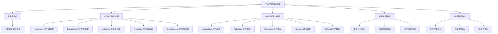
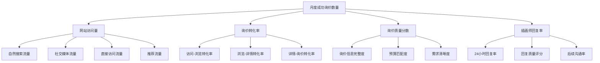
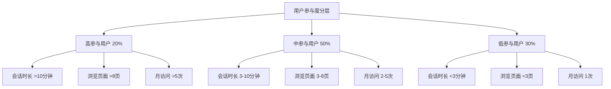
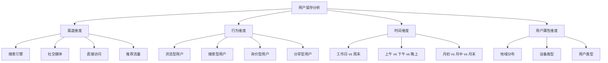
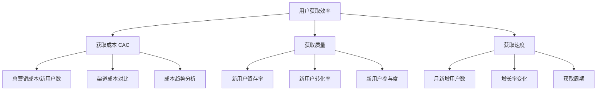
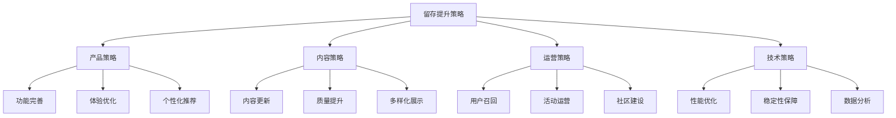
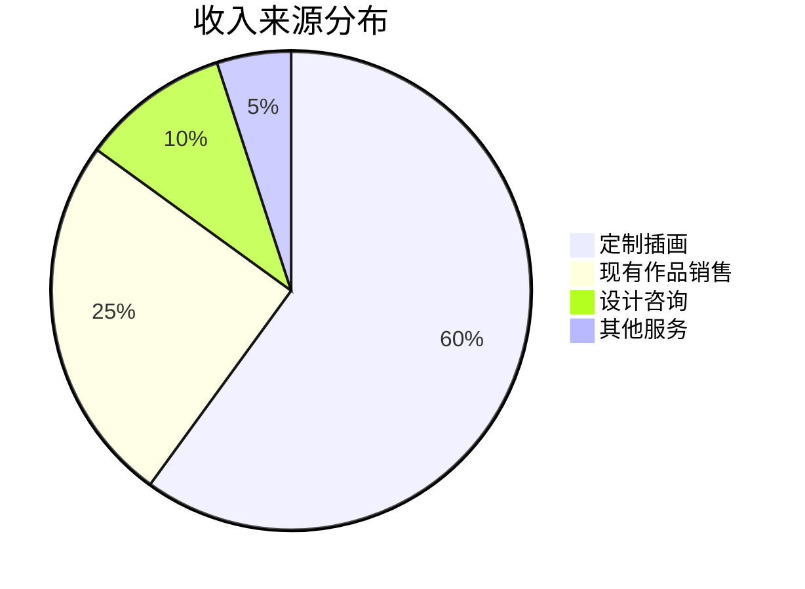
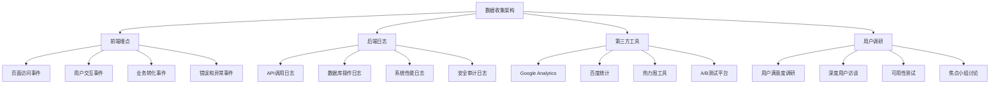
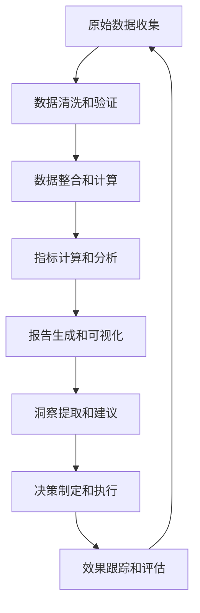
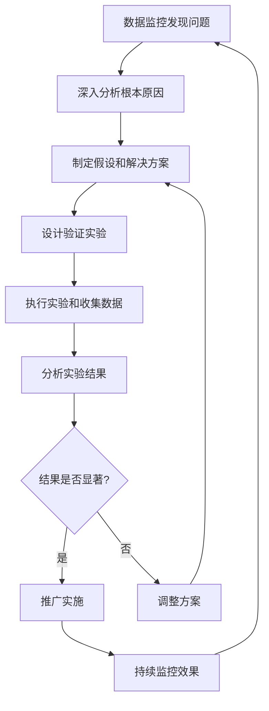

# 产品评估指标框架 (Metrics Framework)

## 1. 指标框架概述

### 1.1 框架目的

本指标框架旨在为KDP.Cool插画师作品展示网站建立全面、科学的产品成功评估体系，通过数据驱动的方式指导产品迭代和业务决策，确保产品能够持续为用户创造价值并实现商业目标。

### 1.2 指标体系架构



### 1.3 指标分类原则

- **战略层指标**: 反映产品整体成功的核心指标
- **战术层指标**: 反映具体功能和用户体验的指标
- **操作层指标**: 反映日常运营和技术状况的指标
- **领先指标**: 能够预测未来趋势的指标
- **滞后指标**: 反映已发生结果的指标

## 2. 北极星指标定义

### 2.1 北极星指标选择

**指标名称**: 月度成功询价数量 (Monthly Successful Inquiries)  
**指标定义**: 每月通过网站询价表单提交且获得插画师回复的有效询价数量

### 2.2 选择依据

#### 2.2.1 业务价值对齐
- **直接反映核心价值**: 询价是网站为插画师带来商业机会的直接体现
- **用户价值体现**: 成功询价意味着潜在客户找到了合适的插画师
- **商业模式验证**: 询价量直接关联未来的收入潜力

#### 2.2.2 可衡量性
- **数据清晰**: 询价提交和回复状态易于跟踪
- **计算简单**: 统计方法明确，不易产生歧义
- **实时监控**: 可以实时跟踪和分析

#### 2.2.3 可影响性
- **产品优化**: 通过改进网站功能可以直接影响询价量
- **用户体验**: 提升用户体验可以提高询价转化率
- **内容质量**: 优化作品展示可以吸引更多有效询价

### 2.3 目标设定

| 阶段 | 时间 | 目标值 | 增长率 | 关键策略 |
|------|------|--------|--------|----------|
| MVP验证 | 第1-3月 | 10个/月 | - | 验证产品核心价值 |
| 初期增长 | 第4-6月 | 25个/月 | 150% | 优化用户体验，提升转化 |
| 稳定增长 | 第7-12月 | 50个/月 | 100% | 扩大用户基数，提升品牌 |
| 规模化 | 第13-24月 | 100个/月 | 100% | 平台化运营，生态建设 |

### 2.4 支撑指标体系



## 3. HEART指标体系详述

### 3.1 Happiness (用户满意度)

#### 3.1.1 指标定义
衡量用户对产品的整体满意度和情感体验

#### 3.1.2 具体指标

| 指标名称 | 计算方法 | 目标值 | 数据来源 | 监测频率 |
|----------|----------|--------|----------|----------|
| 用户满意度评分 | NPS调研平均分 | >4.0/5.0 | 用户调研 | 月度 |
| 客户推荐意愿 | NPS推荐者比例 | >50% | NPS调研 | 季度 |
| 用户投诉率 | 投诉数/总用户数 | <1% | 客服记录 | 月度 |
| 正面评价比例 | 正面评价/总评价 | >80% | 评价系统 | 月度 |
| 社交媒体情感 | 正面提及/总提及 | >70% | 社交监控 | 周度 |

#### 3.1.3 数据收集方法
- **用户调研**: 定期发送满意度调研问卷
- **NPS调研**: 季度进行净推荐值调研
- **用户访谈**: 月度深度用户访谈
- **社交监控**: 监控社交媒体提及和评价
- **客服反馈**: 收集客服沟通中的用户反馈

### 3.2 Engagement (用户参与度)

#### 3.2.1 指标定义
衡量用户与产品的互动深度和频率

#### 3.2.2 具体指标

| 指标名称 | 计算方法 | 目标值 | 数据来源 | 监测频率 |
|----------|----------|--------|----------|----------|
| 平均会话时长 | 总会话时长/会话数 | >5分钟 | 网站分析 | 日度 |
| 页面浏览深度 | 平均每次访问页面数 | >4页 | 网站分析 | 日度 |
| 作品查看率 | 查看作品详情/访问用户 | >60% | 埋点数据 | 日度 |
| 搜索使用率 | 使用搜索/总访问 | >30% | 埋点数据 | 周度 |
| 分享互动率 | 分享次数/作品浏览 | >5% | 埋点数据 | 周度 |
| 重复访问率 | 重复访问用户/总用户 | >40% | 网站分析 | 月度 |

#### 3.2.3 参与度分层分析



### 3.3 Adoption (功能采用率)

#### 3.3.1 指标定义
衡量用户对产品各项功能的使用情况

#### 3.3.2 核心功能采用率

| 功能模块 | 采用率计算 | 目标值 | 重要性 | 优化优先级 |
|----------|------------|--------|--------|------------|
| 作品分类浏览 | 使用分类/总访问 | >70% | 高 | P0 |
| 作品详情查看 | 查看详情/浏览作品 | >50% | 高 | P0 |
| 搜索功能 | 使用搜索/总访问 | >30% | 中 | P1 |
| 询价表单 | 提交询价/访问用户 | >5% | 高 | P0 |
| 个人简介查看 | 查看简介/总访问 | >40% | 中 | P1 |
| 社交分享 | 分享次数/作品浏览 | >3% | 低 | P2 |
| 收藏功能 | 收藏次数/作品浏览 | >8% | 中 | P1 |

#### 3.3.3 功能使用漏斗

```mermaid
funnel
    title 功能使用转化漏斗
    "网站访问" : 1000
    "浏览作品" : 700
    "查看详情" : 350
    "查看简介" : 140
    "提交询价" : 35
    "成功转化" : 7
```

### 3.4 Retention (用户留存率)

#### 3.4.1 指标定义
衡量用户在不同时间周期内的回访情况

#### 3.4.2 留存率指标

| 留存周期 | 计算方法 | 目标值 | 行业基准 | 优化策略 |
|----------|----------|--------|----------|----------|
| 次日留存率 | D1回访/D0新用户 | >25% | 20-30% | 首次体验优化 |
| 7日留存率 | D7回访/D0新用户 | >15% | 10-20% | 价值传递优化 |
| 30日留存率 | D30回访/D0新用户 | >8% | 5-10% | 长期价值建立 |
| 90日留存率 | D90回访/D0新用户 | >5% | 3-8% | 用户习惯养成 |

#### 3.4.3 留存率分析维度



### 3.5 Task Success (任务成功率)

#### 3.5.1 指标定义
衡量用户完成关键任务的成功率和效率

#### 3.5.2 关键任务成功率

| 任务类型 | 成功率计算 | 目标值 | 平均耗时目标 | 优化重点 |
|----------|------------|--------|--------------|----------|
| 找到目标作品 | 成功找到/尝试查找 | >80% | <2分钟 | 搜索和分类优化 |
| 查看作品详情 | 成功查看/点击作品 | >95% | <10秒 | 页面加载优化 |
| 了解插画师信息 | 查看完整简介/访问简介 | >70% | <1分钟 | 信息架构优化 |
| 提交询价表单 | 成功提交/开始填写 | >85% | <3分钟 | 表单流程优化 |
| 完成支付流程 | 支付成功/开始支付 | >95% | <2分钟 | 支付体验优化 |

#### 3.5.3 任务失败原因分析

| 失败环节 | 主要原因 | 影响程度 | 解决方案 |
|----------|----------|----------|----------|
| 作品查找失败 | 分类不清晰、搜索结果不准确 | 高 | 优化分类体系和搜索算法 |
| 页面加载失败 | 图片过大、网络问题 | 高 | 图片优化、CDN加速 |
| 表单提交失败 | 验证错误、网络中断 | 中 | 表单验证优化、错误处理 |
| 支付流程中断 | 支付接口问题、用户取消 | 中 | 支付流程简化、多渠道支持 |

## 4. AARRR漏斗指标

### 4.1 Acquisition (用户获取)

#### 4.1.1 获取渠道指标

| 渠道类型 | 关键指标 | 目标值 | 成本目标 | 质量评估 |
|----------|----------|--------|----------|----------|
| 自然搜索 (SEO) | 自然流量占比 | >40% | 免费 | 高质量，转化率高 |
| 社交媒体 | 社交流量占比 | >25% | 低成本 | 中等质量，参与度高 |
| 直接访问 | 直接流量占比 | >20% | 免费 | 高质量，忠诚度高 |
| 推荐流量 | 推荐流量占比 | >10% | 免费 | 高质量，转化率高 |
| 付费广告 | 付费流量占比 | >5% | 可控成本 | 质量可控 |

#### 4.1.2 获取效率指标



### 4.2 Activation (用户激活)

#### 4.2.1 激活定义
用户在首次访问后完成以下任意一项关键行为：
- 浏览超过3个作品详情页
- 查看插画师个人简介
- 使用搜索或分类功能
- 停留时间超过3分钟

#### 4.2.2 激活指标

| 激活指标 | 计算方法 | 目标值 | 优化策略 |
|----------|----------|--------|----------|
| 整体激活率 | 激活用户/新访问用户 | >60% | 首页体验优化 |
| 首页跳出率 | 单页访问/总访问 | <40% | 内容吸引力提升 |
| 首次会话时长 | 新用户平均会话时长 | >3分钟 | 用户引导优化 |
| 核心功能使用率 | 使用核心功能/新用户 | >50% | 功能引导设计 |

#### 4.2.3 激活漏斗优化

```mermaid
funnel
    title 用户激活转化漏斗
    "首次访问" : 1000
    "浏览首页" : 800
    "点击作品" : 600
    "查看详情" : 450
    "深度浏览" : 300
    "完成激活" : 200
```

### 4.3 Retention (用户留存)

#### 4.3.1 留存策略分层

| 用户分层 | 留存策略 | 关键指标 | 目标值 |
|----------|----------|----------|--------|
| 新用户 (0-7天) | 价值发现引导 | 7日留存率 | >15% |
| 成长用户 (8-30天) | 习惯养成培养 | 30日留存率 | >8% |
| 成熟用户 (31-90天) | 深度价值挖掘 | 90日留存率 | >5% |
| 忠诚用户 (90天+) | 长期关系维护 | 长期活跃率 | >3% |

#### 4.3.2 留存提升策略



### 4.4 Revenue (收入转化)

#### 4.4.1 收入指标体系

| 收入指标 | 计算方法 | 目标值 | 增长目标 |
|----------|----------|--------|----------|
| 月度总收入 | 当月所有订单金额 | 递增 | 20%/月 |
| 平均客单价 | 总收入/订单数量 | >500元 | 稳定增长 |
| 付费用户转化率 | 付费用户/总用户 | >2% | 持续提升 |
| 用户生命周期价值 | 平均用户总贡献 | >1000元 | 长期增长 |
| 询价成交率 | 成交订单/总询价 | >20% | 持续优化 |

#### 4.4.2 收入来源分析



### 4.5 Referral (用户推荐)

#### 4.5.1 推荐指标

| 推荐指标 | 计算方法 | 目标值 | 激励策略 |
|----------|----------|--------|----------|
| 推荐率 | 推荐用户/总用户 | >10% | 推荐奖励计划 |
| 推荐转化率 | 推荐成功/推荐尝试 | >30% | 优化推荐流程 |
| 病毒系数 | 新用户/推荐用户 | >1.2 | 社交功能增强 |
| NPS得分 | 推荐者-贬损者比例 | >50 | 用户体验提升 |

#### 4.5.2 推荐渠道分析

| 推荐渠道 | 占比目标 | 转化效果 | 优化重点 |
|----------|----------|----------|----------|
| 社交媒体分享 | 40% | 高 | 分享功能优化 |
| 口碑推荐 | 35% | 很高 | 服务质量提升 |
| 邮件推荐 | 15% | 中 | 邮件模板优化 |
| 其他渠道 | 10% | 中 | 多渠道探索 |

## 5. 功能级评估指标

### 5.1 作品展示模块

#### 5.1.1 核心指标

| 指标名称 | 计算方法 | 目标值 | 监测频率 |
|----------|----------|--------|----------|
| 作品浏览率 | 查看作品/访问用户 | >70% | 日度 |
| 作品详情转化率 | 查看详情/浏览作品 | >50% | 日度 |
| 平均浏览作品数 | 总作品浏览/访问用户 | >5个 | 日度 |
| 作品分享率 | 分享次数/作品浏览 | >3% | 周度 |
| 高清图查看率 | 查看高清图/详情页访问 | >60% | 日度 |

#### 5.1.2 质量指标

| 质量维度 | 评估指标 | 目标值 | 数据来源 |
|----------|----------|--------|----------|
| 加载性能 | 图片加载时间 | <2秒 | 性能监控 |
| 展示效果 | 用户满意度评分 | >4.0 | 用户调研 |
| 分类准确性 | 分类使用率 | >60% | 用户行为 |
| 搜索相关性 | 搜索结果点击率 | >40% | 搜索数据 |

### 5.2 询价系统模块

#### 5.2.1 转化指标

| 转化环节 | 指标名称 | 目标值 | 优化重点 |
|----------|----------|--------|----------|
| 表单访问 | 询价页面访问率 | >15% | 入口优化 |
| 表单填写 | 表单开始填写率 | >60% | 表单设计 |
| 表单提交 | 表单提交完成率 | >80% | 流程优化 |
| 询价回复 | 插画师回复率 | >90% | 通知机制 |
| 后续沟通 | 深度沟通率 | >50% | 沟通工具 |

#### 5.2.2 质量指标

| 质量维度 | 评估方法 | 目标值 | 改进措施 |
|----------|----------|--------|----------|
| 询价完整度 | 必填字段完成率 | >95% | 表单验证优化 |
| 需求清晰度 | 人工评估打分 | >4.0/5.0 | 引导文案优化 |
| 预算合理性 | 预算范围匹配度 | >70% | 价格指导完善 |
| 联系有效性 | 联系方式有效率 | >95% | 验证机制加强 |

### 5.3 个人品牌模块

#### 5.3.1 浏览指标

| 指标名称 | 计算方法 | 目标值 | 影响因素 |
|----------|----------|--------|----------|
| 简介页面访问率 | 访问简介/总访问 | >40% | 入口设计 |
| 简介完整浏览率 | 完整浏览/访问简介 | >60% | 内容质量 |
| 联系方式点击率 | 点击联系/访问简介 | >20% | 联系方式设计 |
| 社交链接点击率 | 点击社交/访问简介 | >10% | 社交媒体整合 |

#### 5.3.2 信任建立指标

| 信任指标 | 评估方法 | 目标值 | 提升策略 |
|----------|----------|--------|----------|
| 专业度感知 | 用户调研评分 | >4.2/5.0 | 专业经历完善 |
| 可信度评估 | 用户调研评分 | >4.0/5.0 | 客户评价展示 |
| 风格匹配度 | 用户反馈分析 | >75% | 作品分类优化 |
| 合作意愿度 | 询价转化率 | >5% | 整体体验提升 |

## 6. 指标监测计划

### 6.1 监测频率规划

#### 6.1.1 实时监控指标
- 网站访问量和在线用户数
- 系统性能指标（响应时间、错误率）
- 关键业务事件（询价提交、支付完成）
- 安全相关指标（异常访问、攻击尝试）

#### 6.1.2 日度监控指标
- 用户行为指标（PV、UV、会话时长）
- 功能使用指标（搜索、分类、详情查看）
- 转化漏斗指标（各环节转化率）
- 内容质量指标（作品浏览、分享）

#### 6.1.3 周度监控指标
- 用户留存率（7日留存）
- 功能采用率变化
- 用户反馈汇总
- 竞品动态分析

#### 6.1.4 月度监控指标
- 北极星指标（月度成功询价数）
- 收入相关指标
- 用户满意度调研
- 产品迭代效果评估

### 6.2 数据收集架构



### 6.3 数据分析流程

#### 6.3.1 数据处理流程



#### 6.3.2 分析维度框架

| 分析维度 | 具体内容 | 分析目的 | 输出结果 |
|----------|----------|----------|----------|
| 时间维度 | 趋势分析、周期性分析 | 发现变化规律 | 趋势报告 |
| 用户维度 | 用户分群、行为分析 | 理解用户差异 | 用户画像 |
| 功能维度 | 功能使用、效果评估 | 优化产品功能 | 功能优化建议 |
| 渠道维度 | 渠道效果、成本分析 | 优化获客策略 | 渠道优化方案 |
| 业务维度 | 转化分析、收入分析 | 提升商业效果 | 业务优化策略 |

### 6.4 报告体系设计

#### 6.4.1 日常报告

**日报内容**:
- 关键指标概览（访问量、询价数、转化率）
- 异常数据预警
- 系统性能状态
- 重要业务事件

**周报内容**:
- 周度指标汇总和对比
- 用户行为趋势分析
- 功能使用情况分析
- 问题和改进建议

**月报内容**:
- 北极星指标达成情况
- HEART指标全面分析
- 用户调研结果汇总
- 产品迭代效果评估
- 下月优化计划

#### 6.4.2 专项报告

**功能上线报告**:
- 新功能使用情况
- 用户反馈汇总
- 对整体指标的影响
- 优化建议

**A/B测试报告**:
- 测试设计和执行
- 数据结果分析
- 统计显著性检验
- 决策建议

**用户调研报告**:
- 调研设计和执行
- 定量和定性结果
- 用户洞察提取
- 产品改进建议

### 6.5 数据驱动决策机制

#### 6.5.1 决策流程



#### 6.5.2 决策标准

| 决策类型 | 数据要求 | 置信度要求 | 决策周期 |
|----------|----------|------------|----------|
| 紧急修复 | 明确的负面影响 | >90% | 24小时内 |
| 功能优化 | A/B测试验证 | >95% | 1-2周 |
| 产品迭代 | 多维度数据支撑 | >95% | 1个月 |
| 战略调整 | 长期趋势分析 | >99% | 1个季度 |

#### 6.5.3 指标预警机制

| 预警级别 | 触发条件 | 响应时间 | 处理流程 |
|----------|----------|----------|----------|
| 红色预警 | 核心指标下降>20% | 1小时内 | 立即分析和处理 |
| 橙色预警 | 重要指标下降>10% | 4小时内 | 深入分析和制定方案 |
| 黄色预警 | 一般指标异常 | 24小时内 | 监控和分析趋势 |
| 蓝色预警 | 指标波动提醒 | 72小时内 | 记录和定期回顾 |

---

**文档版本**: v1.0  
**最后更新**: 2024-01-01  
**文档状态**: 待评审  
**相关文档**: PRD.md, Roadmap.md, User_Story_Map.md  
**下一步行动**: 数据团队评审 → 监控系统搭建 → 基线数据收集