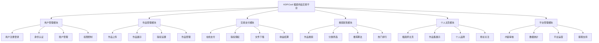
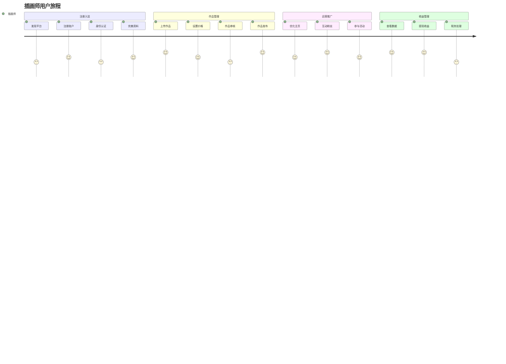
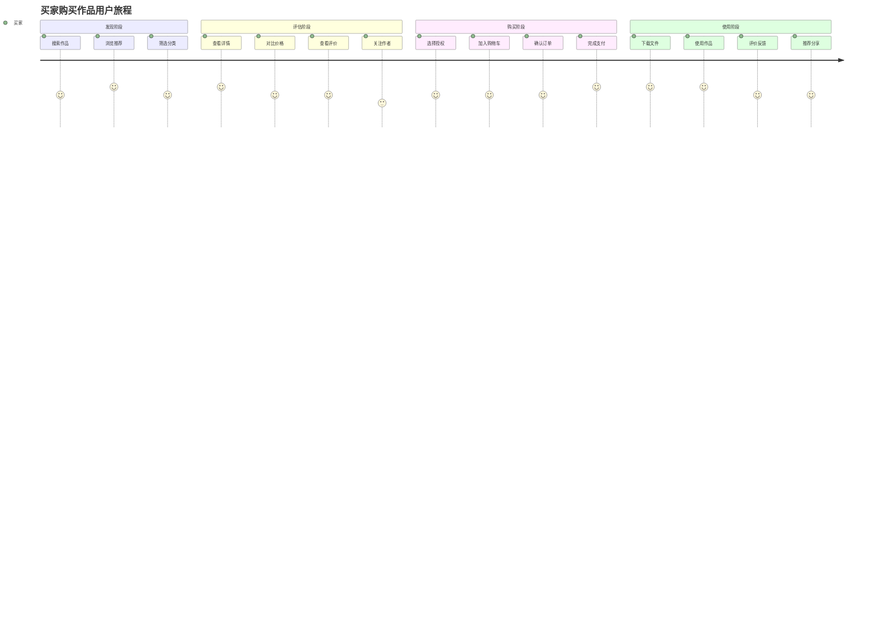
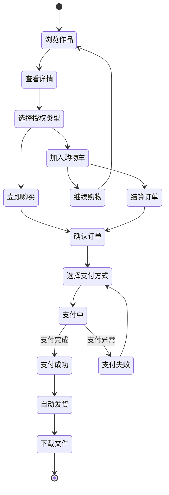
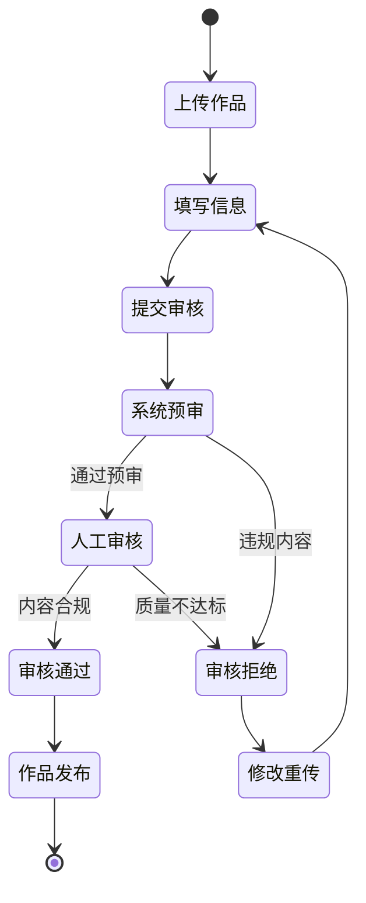
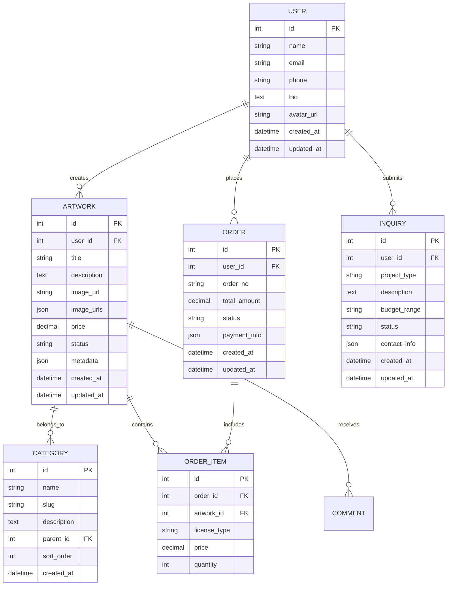

# 插画作品交易平台产品需求文档 (PRD)

## 1. 文档信息

### 1.1 版本历史
| 版本 | 日期 | 修改内容 | 作者 |
|------|------|----------|------|
| v1.0 | 2024-01-01 | 初始版本 | 产品经理 |
| v2.0 | 2024-01-02 | 重大需求变更：从个人展示网站改为多用户作品交易平台 | 产品经理 |

### 1.2 文档目的
本文档旨在详细描述多用户插画作品交易平台的产品需求，为设计、开发、测试团队提供明确的产品规格说明。

### 1.3 相关文档引用
- 产品路线图 (Roadmap.md)
- 用户故事地图 (User_Story_Map.md)
- 产品评估指标框架 (Metrics_Framework.md)

## 2. 产品概述

### 2.1 产品名称与定位
**产品名称**: KDP.Cool - 插画作品交易平台
**产品定位**: 面向插画师和买家的专业数字艺术作品交易平台

### 2.2 产品愿景与使命
**愿景**: 成为连接全球插画师与买家的领先数字艺术交易平台，让创意价值得到公平体现
**使命**: 为插画师提供专业的作品展示和销售平台，为买家提供丰富优质的插画资源，通过技术创新促进数字艺术市场的繁荣发展

### 2.3 价值主张与独特卖点(USP)
- **多用户生态系统**: 支持插画师注册、上传作品，买家浏览、购买的完整生态
- **灵活的版权交易**: 支持作品下载授权和完整商用版权两种交易模式
- **个人主页展示**: 每位插画师拥有独立的个人主页，展示作品集和个人品牌
- **安全的支付体系**: 集成可靠的在线支付系统，保障交易安全
- **作品版权保护**: 通过水印、版权声明等方式保护创作者权益

### 2.4 目标平台列表
- **Web桌面端** (主要平台)
- **移动端Web** (响应式适配)
- **平板端Web** (响应式适配)
- **移动端App** (未来规划)

### 2.5 产品核心假设
- 插画师需要专业平台展示和销售作品
- 买家愿意为高质量插画作品付费
- 版权分级销售模式能满足不同用户需求
- 社区化的展示方式能促进作品传播和销售

### 2.6 商业模式概述
- **交易佣金**: 从每笔成功交易中收取一定比例佣金
- **会员服务**: 为插画师提供高级展示功能和营销工具
- **广告收入**: 为优质作品和插画师提供推广服务
- **增值服务**: 提供作品定制、版权咨询等专业服务

## 3. 用户研究

### 3.1 目标用户画像

#### 3.1.1 人口统计特征
**主要用户群体**:
- **插画师/创作者** (40%): 18-45岁，自由职业者或兼职创作者，寻求作品变现渠道
- **企业买家** (35%): 25-50岁，企业决策者、市场营销人员、设计师，需要商用插画
- **个人买家** (20%): 20-60岁，艺术爱好者、内容创作者，购买个人使用授权
- **浏览用户** (5%): 18-65岁，对插画艺术感兴趣的普通用户

#### 3.1.2 行为习惯与偏好
**插画师群体**:
- 习惯使用专业设计软件创作
- 重视作品版权保护和收益分成
- 希望有个人品牌展示空间
- 需要便捷的作品上传和管理工具

**买家群体**:
- 通过关键词和分类快速筛选作品
- 重视作品的商用授权范围和价格透明度
- 希望便捷的在线支付和下载流程
- 移动端浏览占比约45%

#### 3.1.3 核心需求与痛点
**插画师核心需求**:
- 专业的作品展示平台
- 灵活的定价和版权授权设置
- 安全的收益结算系统
- 个人品牌建设工具

**买家核心需求**:
- 丰富的高质量作品资源
- 清晰的版权授权说明
- 便捷的搜索和筛选功能
- 安全的支付和下载体验

**主要痛点**:
- 传统平台佣金过高或版权保护不足
- 作品定价和授权范围不够灵活
- 支付流程复杂，用户体验差
- 缺乏有效的作品推广和发现机制

#### 3.1.4 动机与目标
- **插画师**: 通过作品销售获得收入，建立个人品牌，扩大影响力
- **企业买家**: 获得高质量商用插画，降低设计成本，提升品牌形象
- **个人买家**: 获得个人使用的插画资源，支持喜爱的创作者

### 3.2 用户场景分析

#### 3.2.1 核心使用场景详述
**场景1: 插画师上传和销售作品**
- 注册账户并完善个人资料
- 上传作品并设置标题、描述、标签
- 设定不同授权类型的价格
- 管理作品销售数据和收益
- 维护个人主页和作品集

**场景2: 企业买家购买商用版权**
- 通过分类或搜索找到合适作品
- 查看作品详情和商用授权范围
- 选择商用版权并完成支付
- 下载高分辨率文件和授权证书
- 联系插画师进行定制合作

**场景3: 个人买家下载个人使用授权**
- 浏览热门作品或特定主题
- 查看作品详情和个人使用授权
- 购买下载授权并完成支付
- 下载标准分辨率文件
- 关注喜爱的插画师

#### 3.2.2 边缘使用场景考量
- 移动端快速浏览和收藏作品
- 社交媒体分享作品链接
- 批量购买多个作品的企业用户
- 定制作品委托和沟通流程

## 4. 市场与竞品分析

### 4.1 市场规模与增长预测
- 全球插画市场规模持续增长，数字化展示需求旺盛
- 个人品牌建设和自由职业者经济快速发展
- 线上艺术品交易和定制服务市场扩大

### 4.2 行业趋势分析
- 视觉内容消费需求持续增长
- 个性化和定制化服务受到青睐
- 移动端浏览和社交分享成为主流
- 专业作品集网站成为行业标配

### 4.3 竞争格局分析

#### 4.3.1 直接竞争对手详析
**Behance**
- 优势: 用户基数大、社区活跃、Adobe生态整合
- 劣势: 个人品牌突出度不够、商业化功能有限
- 定价: 免费使用，付费高级功能

**Dribbble**
- 优势: 设计师社区认知度高、作品质量较高
- 劣势: 偏向UI/UX设计、插画内容相对较少
- 定价: 免费基础版，Pro版$12/月

#### 4.3.2 间接竞争对手概述
- 个人网站建设平台 (Squarespace, Wix)
- 社交媒体平台 (Instagram, Pinterest)
- 在线作品集平台 (Carbonmade, Format)

### 4.4 竞品功能对比矩阵

| 功能特性 | KDP.Cool | Behance | Dribbble | Squarespace |
|----------|----------|---------|----------|-------------|
| 作品分类展示 | ✅ | ✅ | ✅ | ✅ |
| 高清作品展示 | ✅ | ✅ | ✅ | ✅ |
| 个人品牌定制 | ✅ | ❌ | ❌ | ✅ |
| 直接购买功能 | ✅ | ❌ | ❌ | ✅ |
| 询价联系系统 | ✅ | ❌ | ❌ | ✅ |
| 移动端优化 | ✅ | ✅ | ✅ | ✅ |
| SEO优化 | ✅ | ✅ | ✅ | ✅ |

### 4.5 市场差异化策略
- **专注插画领域**: 针对插画师的专业需求优化功能和界面
- **商业闭环完整**: 从展示到交易的一站式解决方案
- **个人品牌突出**: 强化个人故事和创作理念的展示
- **用户体验优化**: 简洁直观的界面设计和流畅的交互体验

## 5. 产品功能需求

### 5.1 功能架构与模块划分

### 5.2 核心功能详述

#### 5.2.1 用户注册登录模块

**功能描述**: 
作为一个用户，我想要注册账户并登录平台，以便上传作品、购买作品或管理个人信息。

**用户价值**: 
- 建立个人账户，享受个性化服务
- 保护用户数据和交易安全
- 支持多种登录方式，提升用户体验

**功能逻辑与规则**:
- 支持邮箱注册和手机号注册
- 支持第三方登录（微信、QQ、微博、Google）
- 注册时需要选择用户类型：插画师/普通用户
- 插画师需要上传身份证明和作品集进行认证
- 密码强度要求：至少8位，包含字母和数字
- 支持找回密码功能（邮箱/短信验证）
- 登录状态保持7天，支持记住登录

**交互要求**:
- 注册登录表单简洁明了，减少用户输入负担
- 实时验证用户输入，及时提示错误信息
- 第三方登录按钮醒目，一键授权登录
- 移动端适配，支持指纹/面部识别登录

**数据需求**:
- 用户基本信息：用户名、邮箱、手机号、头像
- 认证信息：身份证明、插画师资质证书
- 登录记录：登录时间、IP地址、设备信息
- 第三方账户绑定信息

**技术依赖**:
- JWT Token认证机制
- 第三方OAuth2.0授权服务
- 短信验证服务
- 图片上传和存储服务

**验收标准**:
- 注册流程在3分钟内完成
- 登录响应时间 < 2s
- 支持主流第三方平台登录
- 密码加密存储，符合安全标准
- 插画师认证审核流程完整

#### 5.2.2 作品上传管理模块

**功能描述**:
作为一个插画师，我想要上传我的作品并设置销售信息，以便在平台上展示和销售我的创作。

**用户价值**:
- 便捷地管理和展示个人作品集
- 设置灵活的版权授权和定价策略
- 通过平台获得作品曝光和销售机会

**功能逻辑与规则**:
- 支持批量上传图片文件（JPG、PNG、WebP格式）
- 单个文件大小限制20MB，单次最多上传50张
- 必填信息：作品标题、描述、分类、标签
- 版权设置：个人使用授权价格、商用授权价格
- 支持设置作品为免费下载或付费下载
- 作品状态管理：草稿、审核中、已发布、已下架
- 支持作品编辑和版本管理
- 自动生成多种尺寸缩略图

**交互要求**:
- 拖拽上传界面，支持文件夹批量选择
- 上传进度实时显示，支持断点续传
- 作品信息表单智能提示和自动补全
- 版权价格设置向导，提供市场参考价格
- 移动端支持相机直接拍摄上传

**数据需求**:
- 作品文件：原图、缩略图、水印图
- 作品信息：标题、描述、分类、标签、创作时间
- 版权信息：个人授权价格、商用授权价格、授权条款
- 统计数据：浏览量、下载量、收藏量、评分
- 审核记录：审核状态、审核意见、审核时间

**技术依赖**:
- 云存储服务（阿里云OSS/腾讯云COS）
- 图片处理服务（压缩、水印、格式转换）
- 内容审核API（图片内容安全检测）
- 搜索引擎服务（作品索引和检索）

**验收标准**:
- 单张图片上传时间 < 30s
- 支持主流图片格式和尺寸
- 批量上传成功率 > 95%
- 自动生成的缩略图清晰度符合要求
- 作品审核流程在24小时内完成

#### 5.2.3 在线支付交易模块

**功能描述**:
作为一个用户，我想要安全便捷地购买作品授权或下载权限，以便获得合法的作品使用权。

**用户价值**:
- 提供安全可靠的在线支付体验
- 支持多种支付方式，满足不同用户需求
- 自动化授权流程，即时获得使用权限

**功能逻辑与规则**:
- 支持微信支付、支付宝、银行卡支付
- 购买类型：个人使用授权、商用授权、独家授权
- 价格策略：固定价格、阶梯定价、批量折扣
- 支付流程：选择授权类型 → 确认订单 → 支付 → 获得授权
- 订单状态：待支付、已支付、已完成、已退款
- 支持7天无理由退款（未下载情况下）
- 自动生成电子发票和授权证书
- 平台抽成比例：个人授权15%，商用授权20%

**交互要求**:
- 购买流程简洁明了，减少用户操作步骤
- 支付页面安全提示，增强用户信任
- 支付成功后立即跳转到下载页面
- 移动端支持指纹/面部识别快捷支付
- 订单详情页面信息完整清晰

**数据需求**:
- 订单信息：订单号、商品信息、金额、支付方式
- 支付记录：支付时间、支付状态、交易流水号
- 授权信息：授权类型、授权期限、使用范围
- 发票信息：发票抬头、税号、开票金额
- 退款记录：退款原因、退款金额、退款状态

**技术依赖**:
- 第三方支付接口（微信支付、支付宝）
- 银行卡支付网关
- 电子发票开具服务
- 数字签名和加密服务
- 风控系统（反欺诈检测）

**验收标准**:
- 支付成功率 > 98%
- 支付响应时间 < 5s
- 支持主流支付方式
- 退款处理时间 < 3个工作日
- 电子发票自动生成功能正常

#### 5.2.4 作品搜索发现模块

**功能描述**:
作为一个用户，我想要快速搜索和发现感兴趣的插画作品，以便找到符合需求的创作内容。

**用户价值**:
- 高效精准地找到目标作品
- 发现优质创作者和热门作品
- 获得个性化的作品推荐

**功能逻辑与规则**:
- 支持关键词搜索：作品标题、描述、标签、作者名
- 高级筛选：分类、风格、颜色、尺寸、价格区间
- 排序方式：最新、最热、价格、评分、下载量
- 智能推荐：基于用户浏览历史和偏好
- 搜索联想：自动补全和热门搜索词
- 相似作品推荐：基于图像识别技术
- 搜索结果支持瀑布流和网格布局
- 搜索历史记录和收藏功能

**交互要求**:
- 搜索框支持实时搜索建议
- 筛选条件可多选组合，实时更新结果
- 作品卡片hover显示详细信息
- 移动端支持语音搜索和图片搜索
- 无搜索结果时提供相关推荐

**数据需求**:
- 作品索引：标题、描述、标签、分类、作者
- 用户行为：搜索记录、浏览历史、收藏记录
- 作品特征：颜色分布、风格标签、相似度向量
- 统计数据：搜索热度、点击率、转化率
- 推荐模型：用户画像、物品特征、协同过滤

**技术依赖**:
- Elasticsearch搜索引擎
- 图像识别和相似度计算服务
- 推荐算法引擎
- 语音识别API
- 缓存服务（Redis）

**验收标准**:
- 搜索响应时间 < 500ms
- 搜索结果准确率 > 90%
- 推荐点击率 > 5%
- 支持10万+作品的快速检索
- 移动端搜索体验流畅

#### 5.2.5 个人主页展示模块

**功能描述**:
作为一个插画师，我想要拥有个性化的个人主页，以便展示我的作品集、个人品牌和专业能力。

**用户价值**:
- 建立专业的个人品牌形象
- 集中展示个人作品和成就
- 吸引粉丝关注和商业合作机会

**功能逻辑与规则**:
- 个人资料：头像、昵称、简介、联系方式
- 作品集展示：精选作品、分类展示、时间线
- 统计数据：作品数量、粉丝数、总浏览量、收益
- 社交功能：关注/被关注、点赞、评论、分享
- 个性化设置：主页背景、布局风格、展示顺序
- 认证标识：实名认证、专业认证、平台推荐
- 动态更新：新作品发布、获奖信息、合作动态
- 联系方式：私信、邮箱、社交媒体链接

**交互要求**:
- 主页布局美观，突出个人特色
- 作品展示支持多种布局（网格、瀑布流、轮播）
- 关注按钮醒目，一键关注/取消关注
- 移动端适配，响应式设计
- 加载速度快，图片懒加载

**数据需求**:
- 个人信息：基本资料、认证状态、加入时间
- 作品数据：作品列表、分类、统计信息
- 社交数据：粉丝列表、关注列表、互动记录
- 成就数据：获奖记录、认证证书、推荐标签
- 访问数据：页面浏览量、访客来源、停留时间

**技术依赖**:
- 用户生成内容(UGC)管理系统
- 图片CDN加速服务
- 社交关系图数据库
- 实时消息推送服务
- 数据统计分析服务

**验收标准**:
- 主页加载时间 < 3s
- 支持1000+作品的流畅展示
- 社交功能响应及时
- 移动端体验良好
- 个性化设置保存成功

### 5.3 次要功能描述

#### 5.3.1 消息通知系统
- 站内消息：关注、点赞、评论、购买通知
- 邮件通知：重要交易、系统公告
- 推送通知：移动端实时消息推送
- 消息中心：统一管理所有通知信息

#### 5.3.2 收藏关注功能
- 作品收藏：建立个人收藏夹
- 插画师关注：关注喜欢的创作者
- 收藏夹管理：分类整理收藏内容
- 关注动态：查看关注用户的最新作品

#### 5.3.3 评价评论系统
- 作品评论：用户可对作品进行评论
- 评分系统：5星评分机制
- 评论管理：创作者可回复和管理评论
- 评价展示：在作品页面展示用户评价

#### 5.3.4 数据统计分析
- 个人数据：作品浏览量、下载量、收益统计
- 平台数据：热门作品、优秀创作者排行
- 趋势分析：市场热点、风格趋势
- 报表导出：支持数据报表下载

#### 5.3.5 客服支持系统
- 在线客服：实时聊天支持
- 帮助中心：常见问题和使用指南
- 投诉举报：内容违规举报机制
- 工单系统：问题跟踪和处理

### 5.4 未来功能储备 (Backlog)
- **AI智能推荐**: 基于深度学习的个性化作品推荐
- **区块链版权保护**: 利用区块链技术保护作品版权
- **移动端APP**: iOS和Android原生应用
- **多语言支持**: 国际化多语言版本
- **创作者社区**: 插画师交流学习平台
- **直播创作**: 实时创作过程直播功能
- **NFT数字藏品**: 支持NFT作品发行和交易
- **AI辅助创作**: 提供AI创作工具和素材
- **企业定制服务**: 面向企业的批量定制解决方案
- **作品拍卖功能**: 限量作品竞拍机制

## 6. 用户流程与交互设计指导

### 6.1 核心用户旅程地图

#### 6.1.1 插画师用户旅程

#### 6.1.2 买家用户旅程

### 6.2 关键流程详述与状态转换图

#### 6.2.1 作品购买流程状态转换

#### 6.2.2 作品上传审核流程

### 6.3 对设计师 (UI/UX Agent) 的界面原型参考说明和要求

#### 6.3.1 整体设计原则
- **平台化设计**: 支持多用户、多角色的复杂交互场景
- **信息架构清晰**: 用户、作品、交易信息层次分明
- **视觉一致性**: 统一的设计语言和组件规范
- **响应式设计**: 适配桌面端、平板端、移动端
- **可访问性**: 符合WCAG 2.1 AA级标准

#### 6.3.2 关键页面设计要求

**平台首页设计要求**:
- 顶部导航：Logo、搜索框、用户中心、购物车
- 主视觉区：热门作品轮播、平台特色介绍
- 分类导航：插画分类、风格标签快速入口
- 推荐区域：热门作品、优秀创作者、新人推荐
- 底部信息：平台介绍、帮助中心、联系方式

**作品市场页设计要求**:
- 搜索筛选区：关键词搜索、高级筛选器
- 排序工具栏：最新、最热、价格、评分排序
- 作品网格：瀑布流布局，支持不同尺寸
- 作品卡片：缩略图、标题、价格、作者、评分
- 分页加载：无限滚动或分页导航

**作品详情页设计要求**:
- 作品展示区：高清大图、多图切换、放大查看
- 作品信息区：标题、描述、标签、统计数据
- 购买区域：授权类型选择、价格展示、购买按钮
- 作者信息：头像、昵称、认证标识、关注按钮
- 相关推荐：同作者作品、相似作品

**用户个人主页设计要求**:
- 个人信息：头像、昵称、简介、认证状态
- 作品集展示：网格布局、分类筛选
- 统计数据：作品数、粉丝数、获赞数
- 社交功能：关注按钮、私信入口
- 个性化设置：主页背景、布局风格

**用户中心设计要求**:
- 导航菜单：个人资料、作品管理、订单中心、收益统计
- 仪表盘：关键数据概览、快捷操作入口
- 作品管理：上传、编辑、删除、统计
- 订单管理：购买记录、销售记录、退款处理
- 收益中心：收入统计、提现功能、税务信息

#### 6.3.3 交互设计规范
- **加载状态**: 使用骨架屏或进度条提示
- **错误处理**: 友好的错误提示和解决建议
- **反馈机制**: 操作成功后及时给予反馈
- **无障碍设计**: 支持键盘导航和屏幕阅读器

### 6.4 交互设计规范与原则建议

#### 6.4.1 交互原则
- **一致性**: 相同功能在不同页面保持一致的交互方式
- **可预测性**: 用户能够预期操作的结果
- **容错性**: 允许用户犯错并提供撤销机制
- **效率性**: 减少用户完成任务所需的步骤

#### 6.4.2 具体规范
- **按钮设计**: 主要操作使用醒目颜色，次要操作使用中性色
- **表单设计**: 必填字段明确标识，实时验证反馈
- **导航设计**: 面包屑导航帮助用户了解当前位置
- **搜索设计**: 提供搜索建议和历史记录

## 7. 非功能需求

### 7.1 性能需求

#### 7.1.1 响应时间要求
- 页面首次加载时间 < 3秒
- 页面切换响应时间 < 1秒
- 图片加载时间 < 2秒（缩略图）< 5秒（高清图）
- 搜索结果返回时间 < 500毫秒
- 表单提交响应时间 < 2秒

#### 7.1.2 并发量要求
- 支持同时在线用户数 > 1000
- 峰值并发访问量 > 5000 PV/小时
- 数据库查询响应时间 < 100毫秒

#### 7.1.3 稳定性要求
- 系统可用性 > 99.5%
- 月度故障时间 < 4小时
- 数据备份频率：每日备份，异地存储

#### 7.1.4 资源使用率
- 服务器CPU使用率 < 70%
- 内存使用率 < 80%
- 磁盘使用率 < 85%
- 带宽使用效率 > 80%

### 7.2 安全需求

#### 7.2.1 数据加密
- 传输数据使用HTTPS加密
- 敏感数据（密码、支付信息）使用AES-256加密存储
- 数据库连接使用SSL加密

#### 7.2.2 认证授权
- 管理后台使用双因子认证
- 支持OAuth2.0第三方登录
- 会话管理使用JWT令牌
- 密码策略：最少8位，包含大小写字母和数字

#### 7.2.3 隐私保护
- 遵循GDPR数据保护规定
- 用户数据最小化收集原则
- 提供数据删除和导出功能
- 隐私政策和用户协议明确展示

#### 7.2.4 防攻击策略
- SQL注入防护
- XSS攻击防护
- CSRF攻击防护
- DDoS攻击防护
- 文件上传安全检查
- 访问频率限制（Rate Limiting）

### 7.3 可用性与可访问性标准

#### 7.3.1 易用性要求
- 新用户学习成本 < 5分钟
- 核心功能操作步骤 < 3步
- 错误率 < 5%
- 用户满意度 > 4.0/5.0

#### 7.3.2 可访问性标准
- 遵循WCAG 2.1 AA级标准
- 支持屏幕阅读器
- 键盘导航支持
- 色彩对比度符合标准
- 字体大小可调节

### 7.4 合规性要求

#### 7.4.1 法律法规遵循
- 《网络安全法》合规
- 《个人信息保护法》合规
- 《电子商务法》合规（如涉及销售）
- 版权法相关规定遵循

#### 7.4.2 行业标准
- 支付行业PCI DSS标准（如涉及支付）
- ISO 27001信息安全管理标准
- 网站备案和经营许可证

### 7.5 数据统计与分析需求

#### 7.5.1 关键事件埋点
- 页面访问事件（PV、UV）
- 作品查看事件（作品ID、停留时间）
- 搜索事件（关键词、结果数量）
- 询价事件（表单提交、转化率）
- 购买事件（商品、金额、支付方式）
- 分享事件（平台、作品ID）

#### 7.5.2 用户行为分析
- 用户访问路径分析
- 页面热力图分析
- 用户留存率分析
- 转化漏斗分析
- A/B测试支持

#### 7.5.3 业务指标监控
- 实时访问量监控
- 询价转化率监控
- 作品浏览排行
- 收入统计分析
- 用户反馈统计

## 8. 技术架构考量

### 8.1 技术栈建议

#### 8.1.1 前端技术栈
- **框架**: React.js 或 Vue.js
- **UI组件库**: Ant Design 或 Element UI
- **状态管理**: Redux 或 Vuex
- **构建工具**: Webpack 或 Vite
- **CSS预处理器**: Sass 或 Less
- **移动端适配**: 响应式设计 + PWA

#### 8.1.2 后端技术栈
- **语言**: Node.js (Express) 或 Python (Django/Flask)
- **数据库**: MySQL (主) + Redis (缓存)
- **文件存储**: 阿里云OSS 或 AWS S3
- **搜索引擎**: Elasticsearch
- **消息队列**: RabbitMQ 或 Redis

#### 8.1.3 部署和运维
- **容器化**: Docker + Kubernetes
- **CI/CD**: GitLab CI 或 GitHub Actions
- **监控**: Prometheus + Grafana
- **日志**: ELK Stack
- **CDN**: 阿里云CDN 或 CloudFlare

### 8.2 系统集成需求

#### 8.2.1 第三方服务集成
- **支付服务**: 支付宝、微信支付、银联
- **邮件服务**: 阿里云邮件推送 或 SendGrid
- **短信服务**: 阿里云短信服务
- **地图服务**: 高德地图API（如需要）
- **社交登录**: 微信、QQ、微博OAuth

#### 8.2.2 数据同步需求
- 作品数据与搜索引擎同步
- 订单数据与财务系统同步
- 用户行为数据与分析系统同步

### 8.3 技术依赖与约束

#### 8.3.1 性能约束
- 图片处理和压缩服务
- CDN加速服务必须
- 数据库读写分离
- 缓存策略完善

#### 8.3.2 安全约束
- HTTPS证书必须
- 数据加密存储
- 定期安全扫描
- 备份策略完善

### 8.4 数据模型建议

#### 8.4.1 核心实体关系

## 9. 验收标准汇总

### 9.1 功能验收标准矩阵

| 功能模块 | 验收标准 | 优先级 | 测试方法 |
|----------|----------|--------|----------|
| 作品分类展示 | 支持3级分类，切换响应<500ms | P0 | 自动化测试 |
| 作品详情展示 | 高清图片加载<3s，支持10张图片 | P0 | 性能测试 |
| 个人品牌展示 | 页面加载<2s，富文本正确渲染 | P0 | 功能测试 |
| 商业询价 | 表单提交成功率>95%，自动回复>98% | P0 | 集成测试 |
| 作品购买 | 支付成功率>95%，自动发货<5分钟 | P1 | 端到端测试 |
| 搜索筛选 | 搜索响应<500ms，支持多维度筛选 | P1 | 功能测试 |
| 社交分享 | 支持主流平台，分享成功率>90% | P2 | 集成测试 |

### 9.2 性能验收标准

| 性能指标 | 目标值 | 测试环境 | 测试工具 |
|----------|--------|----------|----------|
| 页面加载时间 | <3秒 | 生产环境 | GTmetrix, PageSpeed |
| 并发用户数 | >1000 | 压测环境 | JMeter, LoadRunner |
| 系统可用性 | >99.5% | 生产环境 | 监控系统 |
| 数据库响应 | <100ms | 生产环境 | APM工具 |

### 9.3 质量验收标准

| 质量指标 | 目标值 | 测试方法 |
|----------|--------|---------|
| 代码覆盖率 | >80% | 单元测试 |
| Bug密度 | <2个/KLOC | 代码审查 |
| 安全漏洞 | 0个高危漏洞 | 安全扫描 |
| 可访问性 | WCAG 2.1 AA | 可访问性测试 |
| 浏览器兼容性 | 支持主流浏览器最新2个版本 | 兼容性测试 |

## 10. 产品成功指标

### 10.1 关键绩效指标 (KPIs) 定义与目标

#### 10.1.1 用户增长指标
- **注册用户数**: 目标10,000+，月增长率30%
- **月活跃用户数 (MAU)**: 目标5,000+，增长率25%/月
- **插画师入驻数**: 目标1,000+，月增长50+
- **用户留存率**: 7日留存>40%，30日留存>20%
- **用户会话时长**: 平均>8分钟

#### 10.1.2 交易转化指标
- **作品购买转化率**: 作品详情页>3%转化为购买
- **平台GMV**: 月交易总额目标100万+
- **客单价**: 平均>200元
- **复购率**: >25%用户重复购买
- **支付成功率**: >98%

#### 10.1.3 内容生态指标
- **作品上传量**: 月新增作品>5,000张
- **作品质量**: 审核通过率>80%
- **作品浏览深度**: 平均每次访问查看>5个作品
- **用户评价分数**: 平均>4.3/5.0
- **作品收藏率**: >15%的作品被收藏

#### 10.1.4 平台运营指标
- **搜索成功率**: >90%搜索产生有效结果
- **客服响应时间**: 平均<2小时
- **投诉处理率**: >95%投诉24小时内处理
- **平台抽成收入**: 月收入目标20万+

#### 10.1.5 技术性能指标
- **页面加载速度**: 95%页面<2秒加载完成
- **系统稳定性**: 月度可用性>99.8%
- **错误率**: <0.5%的请求出现错误
- **移动端使用率**: >50%流量来自移动端

### 10.2 北极星指标定义与选择依据

#### 10.2.1 北极星指标
**月度成功交易订单数**

#### 10.2.2 选择依据
- **业务核心价值**: 直接反映平台为用户创造的价值和商业成功
- **双边市场平衡**: 同时体现买家需求满足和卖家收益实现
- **可衡量性**: 数据清晰，易于跟踪和分析
- **可影响性**: 通过产品优化可以直接影响该指标
- **长期导向**: 与平台长期商业目标一致
- **用户价值体现**: 体现平台真正为用户解决问题的能力

#### 10.2.3 支撑指标
- 平台月活跃用户数
- 作品详情页浏览量
- 购物车添加率
- 支付转化率
- 用户满意度评分
- 插画师收益增长率

### 10.3 指标监测计划

#### 10.3.1 数据收集方案
- **网站分析**: Google Analytics + 百度统计
- **用户行为**: 自建埋点系统
- **业务数据**: 后台管理系统统计
- **用户反馈**: 问卷调查 + 客服记录

#### 10.3.2 报告频率
- **实时监控**: 系统性能、错误率
- **日报**: 访问量、询价数量、订单数量
- **周报**: 用户增长、转化率、内容质量
- **月报**: KPI达成情况、趋势分析、优化建议
- **季报**: 北极星指标分析、产品迭代效果评估

#### 10.3.3 数据分析和优化
- **A/B测试**: 关键页面和功能的优化测试
- **用户调研**: 定期进行用户访谈和问卷调查
- **竞品分析**: 定期分析竞品数据和功能更新
- **数据驱动决策**: 基于数据分析结果制定产品优化计划

---

**文档版本**: v1.0  
**最后更新**: 2024-01-01  
**文档状态**: 待评审  
**下一步行动**: 团队评审 → 技术方案设计 → 开发排期制定