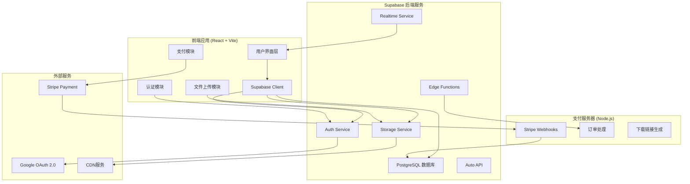
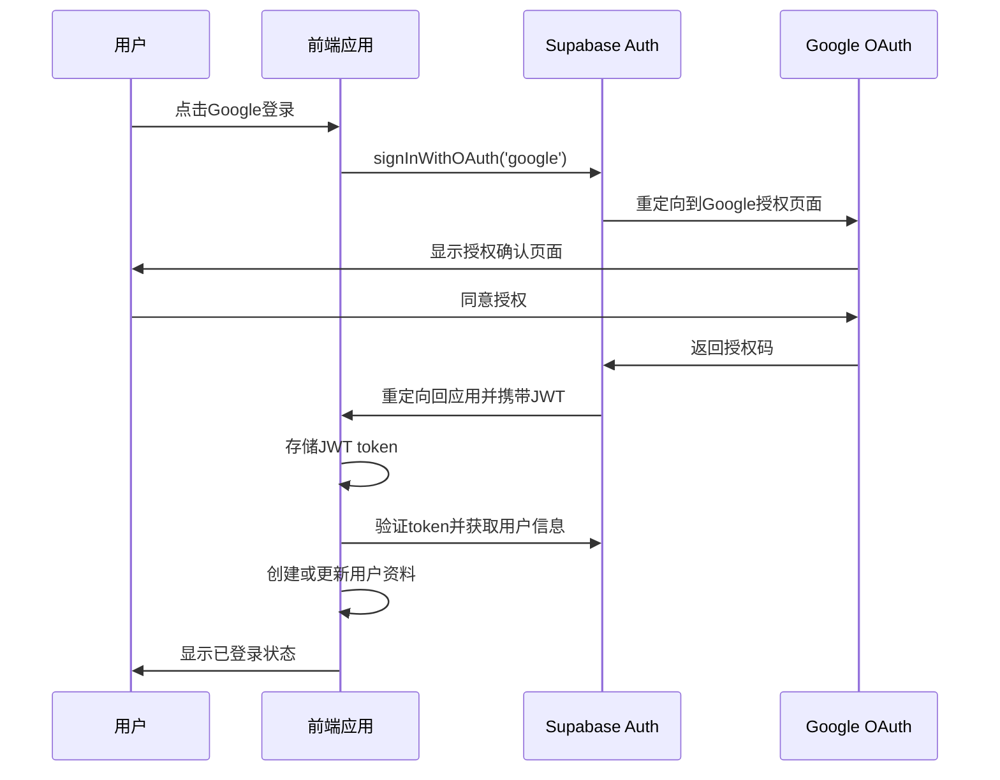

# KDP.Cool 技术架构设计文档

## 文档信息

**版本**: v2.0  
**创建日期**: 2025-01-05  
**架构类型**: Supabase + Google OAuth  
**状态**: 已确认，开始实施  

---

## 🏗️ 系统架构概览

### 技术栈选型

**前端层:**
- React 19 + Vite (构建工具)
- Ant Design (UI组件库)
- Supabase JS Client (数据访问)
- React Router DOM (路由管理)
- Stripe JS (支付前端)

**后端层:**
- Supabase Cloud (主后端服务)
  - PostgreSQL Database
  - Auth Service (Google OAuth)
  - Storage Service
  - Realtime Service
  - Auto-generated API
- Node.js Express (轻量支付服务器)
- Stripe (支付网关)

**部署层:**
- Vercel (前端托管)
- Supabase Cloud (后端托管)
- Railway/Render (支付服务器)

### 架构图



---

## 🗄️ 数据库设计

### 核心表结构

```sql
-- 扩展用户资料表 (基于Supabase auth.users)
CREATE TABLE profiles (
  id UUID REFERENCES auth.users(id) PRIMARY KEY,
  email TEXT UNIQUE NOT NULL,
  name TEXT,
  avatar_url TEXT,
  bio TEXT,
  role TEXT DEFAULT 'artist' CHECK (role IN ('artist', 'buyer', 'admin')),
  website_url TEXT,
  social_links JSONB DEFAULT '{}',
  total_sales INTEGER DEFAULT 0,
  total_earnings DECIMAL(10,2) DEFAULT 0,
  created_at TIMESTAMP DEFAULT NOW(),
  updated_at TIMESTAMP DEFAULT NOW()
);

-- 作品表
CREATE TABLE artworks (
  id UUID DEFAULT gen_random_uuid() PRIMARY KEY,
  author_id UUID REFERENCES auth.users(id) NOT NULL,
  title TEXT NOT NULL,
  description TEXT,
  image_url TEXT NOT NULL,
  thumbnail_url TEXT,
  watermark_url TEXT,
  original_filename TEXT,
  file_size INTEGER,
  dimensions JSONB, -- {width: 1920, height: 1080}
  price DECIMAL(10,2) DEFAULT 0,
  license_type TEXT DEFAULT 'standard' CHECK (license_type IN ('standard', 'extended', 'exclusive')),
  tags TEXT[],
  category TEXT,
  status TEXT DEFAULT 'published' CHECK (status IN ('draft', 'published', 'archived')),
  download_count INTEGER DEFAULT 0,
  view_count INTEGER DEFAULT 0,
  like_count INTEGER DEFAULT 0,
  featured BOOLEAN DEFAULT FALSE,
  created_at TIMESTAMP DEFAULT NOW(),
  updated_at TIMESTAMP DEFAULT NOW()
);

-- 作品分类表
CREATE TABLE categories (
  id UUID DEFAULT gen_random_uuid() PRIMARY KEY,
  name TEXT NOT NULL UNIQUE,
  slug TEXT NOT NULL UNIQUE,
  description TEXT,
  parent_id UUID REFERENCES categories(id),
  sort_order INTEGER DEFAULT 0,
  active BOOLEAN DEFAULT TRUE,
  created_at TIMESTAMP DEFAULT NOW()
);

-- 订单表
CREATE TABLE orders (
  id UUID DEFAULT gen_random_uuid() PRIMARY KEY,
  order_number TEXT UNIQUE NOT NULL, -- ORD-YYYYMMDD-XXXXX
  buyer_id UUID REFERENCES auth.users(id) NOT NULL,
  artwork_id UUID REFERENCES artworks(id) NOT NULL,
  amount DECIMAL(10,2) NOT NULL,
  currency TEXT DEFAULT 'USD',
  license_type TEXT NOT NULL,
  status TEXT DEFAULT 'pending' CHECK (status IN ('pending', 'processing', 'completed', 'failed', 'refunded')),
  
  -- Stripe相关字段
  stripe_payment_intent_id TEXT,
  stripe_charge_id TEXT,
  
  -- 数字交付相关
  download_url TEXT,
  download_expires_at TIMESTAMP,
  download_count INTEGER DEFAULT 0,
  max_downloads INTEGER DEFAULT 3,
  
  -- 元数据
  metadata JSONB DEFAULT '{}',
  notes TEXT,
  
  created_at TIMESTAMP DEFAULT NOW(),
  updated_at TIMESTAMP DEFAULT NOW()
);

-- 收藏表
CREATE TABLE favorites (
  id UUID DEFAULT gen_random_uuid() PRIMARY KEY,
  user_id UUID REFERENCES auth.users(id) NOT NULL,
  artwork_id UUID REFERENCES artworks(id) NOT NULL,
  created_at TIMESTAMP DEFAULT NOW(),
  UNIQUE(user_id, artwork_id)
);

-- 关注表
CREATE TABLE follows (
  id UUID DEFAULT gen_random_uuid() PRIMARY KEY,
  follower_id UUID REFERENCES auth.users(id) NOT NULL,
  following_id UUID REFERENCES auth.users(id) NOT NULL,
  created_at TIMESTAMP DEFAULT NOW(),
  UNIQUE(follower_id, following_id),
  CHECK (follower_id != following_id)
);

-- 评论表
CREATE TABLE comments (
  id UUID DEFAULT gen_random_uuid() PRIMARY KEY,
  artwork_id UUID REFERENCES artworks(id) NOT NULL,
  user_id UUID REFERENCES auth.users(id) NOT NULL,
  content TEXT NOT NULL,
  rating INTEGER CHECK (rating >= 1 AND rating <= 5),
  status TEXT DEFAULT 'published' CHECK (status IN ('published', 'hidden', 'deleted')),
  created_at TIMESTAMP DEFAULT NOW(),
  updated_at TIMESTAMP DEFAULT NOW()
);

-- 下载记录表
CREATE TABLE download_logs (
  id UUID DEFAULT gen_random_uuid() PRIMARY KEY,
  order_id UUID REFERENCES orders(id) NOT NULL,
  user_id UUID REFERENCES auth.users(id) NOT NULL,
  artwork_id UUID REFERENCES artworks(id) NOT NULL,
  download_url TEXT NOT NULL,
  ip_address INET,
  user_agent TEXT,
  downloaded_at TIMESTAMP DEFAULT NOW()
);
```

### 索引优化

```sql
-- 性能优化索引
CREATE INDEX idx_artworks_author_status ON artworks(author_id, status);
CREATE INDEX idx_artworks_category_status ON artworks(category, status);
CREATE INDEX idx_artworks_featured ON artworks(featured) WHERE featured = TRUE;
CREATE INDEX idx_artworks_tags ON artworks USING GIN(tags);
CREATE INDEX idx_artworks_created_at ON artworks(created_at DESC);
CREATE INDEX idx_orders_buyer_status ON orders(buyer_id, status);
CREATE INDEX idx_orders_created_at ON orders(created_at DESC);

-- 全文搜索
CREATE INDEX idx_artworks_search ON artworks USING GIN(
  to_tsvector('english', title || ' ' || COALESCE(description, ''))
);
```

### 行级安全策略 (RLS)

```sql
-- 启用行级安全
ALTER TABLE profiles ENABLE ROW LEVEL SECURITY;
ALTER TABLE artworks ENABLE ROW LEVEL SECURITY;
ALTER TABLE orders ENABLE ROW LEVEL SECURITY;
ALTER TABLE favorites ENABLE ROW LEVEL SECURITY;
ALTER TABLE follows ENABLE ROW LEVEL SECURITY;
ALTER TABLE comments ENABLE ROW LEVEL SECURITY;

-- 用户资料安全策略
CREATE POLICY "用户可以查看所有公开资料" ON profiles
  FOR SELECT USING (TRUE);

CREATE POLICY "用户只能编辑自己的资料" ON profiles
  FOR ALL USING (auth.uid() = id);

-- 作品安全策略
CREATE POLICY "所有人可以查看已发布的作品" ON artworks
  FOR SELECT USING (status = 'published');

CREATE POLICY "用户可以管理自己的作品" ON artworks
  FOR ALL USING (auth.uid() = author_id);

-- 订单安全策略
CREATE POLICY "用户只能查看自己的订单" ON orders
  FOR SELECT USING (auth.uid() = buyer_id);

CREATE POLICY "作者可以查看自己作品的订单" ON orders
  FOR SELECT USING (
    EXISTS (
      SELECT 1 FROM artworks 
      WHERE artworks.id = orders.artwork_id 
      AND artworks.author_id = auth.uid()
    )
  );

-- 收藏安全策略
CREATE POLICY "用户可以管理自己的收藏" ON favorites
  FOR ALL USING (auth.uid() = user_id);

CREATE POLICY "所有人可以查看收藏统计" ON favorites
  FOR SELECT USING (TRUE);
```

---

## 🔐 认证架构

### Google OAuth 2.0 集成

```typescript
// lib/supabase.ts
import { createClient } from '@supabase/supabase-js'
import { Database } from '@/types/database'

const supabaseUrl = process.env.NEXT_PUBLIC_SUPABASE_URL!
const supabaseAnonKey = process.env.NEXT_PUBLIC_SUPABASE_ANON_KEY!

export const supabase = createClient<Database>(supabaseUrl, supabaseAnonKey)

// hooks/useAuth.ts
import { useEffect, useState } from 'react'
import { User } from '@supabase/supabase-js'
import { supabase } from '@/lib/supabase'

export const useAuth = () => {
  const [user, setUser] = useState<User | null>(null)
  const [loading, setLoading] = useState(true)

  useEffect(() => {
    // 获取当前用户
    const getUser = async () => {
      const { data: { user } } = await supabase.auth.getUser()
      setUser(user)
      setLoading(false)
    }

    getUser()

    // 监听认证状态变化
    const { data: { subscription } } = supabase.auth.onAuthStateChange(
      async (event, session) => {
        setUser(session?.user ?? null)
        setLoading(false)
        
        // 首次登录时创建用户资料
        if (event === 'SIGNED_IN' && session?.user) {
          await createUserProfile(session.user)
        }
      }
    )

    return () => subscription.unsubscribe()
  }, [])

  const signInWithGoogle = async () => {
    const { error } = await supabase.auth.signInWithOAuth({
      provider: 'google',
      options: {
        redirectTo: `${window.location.origin}/auth/callback`,
        queryParams: {
          access_type: 'offline',
          prompt: 'consent',
        }
      }
    })
    
    if (error) throw error
  }

  const signOut = async () => {
    const { error } = await supabase.auth.signOut()
    if (error) throw error
  }

  return {
    user,
    loading,
    signInWithGoogle,
    signOut
  }
}

// 创建用户资料
const createUserProfile = async (user: User) => {
  const { error } = await supabase
    .from('profiles')
    .upsert({
      id: user.id,
      email: user.email!,
      name: user.user_metadata.full_name,
      avatar_url: user.user_metadata.avatar_url,
    })
  
  if (error) console.error('创建用户资料失败:', error)
}
```

### 认证流程图



---

## 📁 文件存储架构

### Supabase Storage 配置

```typescript
// 存储桶结构
Buckets:
├── artworks/
│   ├── originals/        # 原始高清文件 (只有购买者可下载)
│   ├── thumbnails/       # 缩略图 (公开访问)
│   ├── watermarked/      # 带水印预览图 (公开访问)
│   └── temp/             # 临时上传文件

// lib/storage.ts
import { supabase } from './supabase'

export const uploadArtwork = async (
  file: File,
  userId: string,
  options?: {
    generateThumbnail?: boolean
    addWatermark?: boolean
  }
) => {
  try {
    // 1. 验证文件类型和大小
    const allowedTypes = ['image/jpeg', 'image/png', 'image/webp']
    if (!allowedTypes.includes(file.type)) {
      throw new Error('不支持的文件类型')
    }
    
    if (file.size > 50 * 1024 * 1024) { // 50MB limit
      throw new Error('文件大小不能超过50MB')
    }

    // 2. 生成唯一文件名
    const fileExt = file.name.split('.').pop()
    const fileName = `${crypto.randomUUID()}.${fileExt}`
    const filePath = `originals/${userId}/${fileName}`

    // 3. 上传原始文件
    const { data: uploadData, error: uploadError } = await supabase.storage
      .from('artworks')
      .upload(filePath, file, {
        cacheControl: '3600',
        upsert: false
      })

    if (uploadError) throw uploadError

    // 4. 获取公共URL
    const { data: urlData } = supabase.storage
      .from('artworks')
      .getPublicUrl(filePath)

    // 5. 生成缩略图和水印图 (通过Edge Function)
    let thumbnailUrl = ''
    let watermarkUrl = ''
    
    if (options?.generateThumbnail) {
      thumbnailUrl = await generateThumbnail(filePath)
    }
    
    if (options?.addWatermark) {
      watermarkUrl = await addWatermark(filePath)
    }

    return {
      originalUrl: urlData.publicUrl,
      thumbnailUrl,
      watermarkUrl,
      filePath,
      fileName,
      fileSize: file.size
    }

  } catch (error) {
    console.error('文件上传失败:', error)
    throw error
  }
}

// 生成缩略图 (Supabase Edge Function)
const generateThumbnail = async (originalPath: string): Promise<string> => {
  const { data, error } = await supabase.functions.invoke('generate-thumbnail', {
    body: { originalPath }
  })
  
  if (error) throw error
  return data.thumbnailUrl
}

// 添加水印 (Supabase Edge Function)
const addWatermark = async (originalPath: string): Promise<string> => {
  const { data, error } = await supabase.functions.invoke('add-watermark', {
    body: { originalPath }
  })
  
  if (error) throw error
  return data.watermarkUrl
}
```

### 存储安全策略

```sql
-- 存储桶策略
CREATE POLICY "任何人都可以查看缩略图和水印图" ON storage.objects
  FOR SELECT USING (bucket_id = 'artworks' AND 
    (storage.foldername(name))[1] IN ('thumbnails', 'watermarked'));

CREATE POLICY "只有作者可以上传到自己的文件夹" ON storage.objects
  FOR INSERT WITH CHECK (
    bucket_id = 'artworks' AND 
    auth.uid()::text = (storage.foldername(name))[2]
  );

CREATE POLICY "只有购买者和作者可以访问原始文件" ON storage.objects
  FOR SELECT USING (
    bucket_id = 'artworks' AND 
    (storage.foldername(name))[1] = 'originals' AND
    (
      auth.uid()::text = (storage.foldername(name))[2] OR -- 作者
      EXISTS (
        SELECT 1 FROM orders 
        WHERE orders.buyer_id = auth.uid() 
        AND orders.status = 'completed'
        AND orders.artwork_id::text = (storage.foldername(name))[3]
      )
    )
  );
```

---

## 💳 支付架构

### Stripe 集成方案

```typescript
// lib/stripe.ts
import { loadStripe } from '@stripe/stripe-js'

export const stripePromise = loadStripe(
  process.env.NEXT_PUBLIC_STRIPE_PUBLISHABLE_KEY!
)

// hooks/usePayment.ts
import { useState } from 'react'
import { supabase } from '@/lib/supabase'
import { stripePromise } from '@/lib/stripe'

export const usePayment = () => {
  const [loading, setLoading] = useState(false)

  const createPaymentIntent = async (
    artworkId: string,
    licenseType: 'standard' | 'extended' | 'exclusive'
  ) => {
    setLoading(true)
    
    try {
      // 1. 获取作品信息和价格
      const { data: artwork, error } = await supabase
        .from('artworks')
        .select('*')
        .eq('id', artworkId)
        .single()

      if (error) throw error

      // 2. 计算价格 (基于许可类型)
      const priceMultipliers = {
        standard: 1,
        extended: 2,
        exclusive: 5
      }
      const amount = Math.round(artwork.price * priceMultipliers[licenseType] * 100) // 转换为分

      // 3. 调用后端API创建PaymentIntent
      const response = await fetch('/api/create-payment-intent', {
        method: 'POST',
        headers: {
          'Content-Type': 'application/json',
          'Authorization': `Bearer ${(await supabase.auth.getSession()).data.session?.access_token}`
        },
        body: JSON.stringify({
          artworkId,
          licenseType,
          amount
        })
      })

      const { clientSecret, orderId } = await response.json()

      return { clientSecret, orderId }

    } catch (error) {
      console.error('创建支付意图失败:', error)
      throw error
    } finally {
      setLoading(false)
    }
  }

  const confirmPayment = async (clientSecret: string, orderId: string) => {
    const stripe = await stripePromise
    if (!stripe) throw new Error('Stripe 未加载')

    const { error } = await stripe.confirmPayment({
      clientSecret,
      confirmParams: {
        return_url: `${window.location.origin}/purchase/success?order_id=${orderId}`
      }
    })

    if (error) throw error
  }

  return {
    loading,
    createPaymentIntent,
    confirmPayment
  }
}
```

### 支付后端服务

```javascript
// payment-server/index.js
const express = require('express')
const stripe = require('stripe')(process.env.STRIPE_SECRET_KEY)
const { createClient } = require('@supabase/supabase-js')

const app = express()
const supabase = createClient(
  process.env.SUPABASE_URL,
  process.env.SUPABASE_SERVICE_ROLE_KEY
)

// 创建支付意图
app.post('/api/create-payment-intent', async (req, res) => {
  try {
    const { artworkId, licenseType, amount } = req.body
    
    // 1. 验证用户身份
    const token = req.headers.authorization?.replace('Bearer ', '')
    const { data: { user }, error } = await supabase.auth.getUser(token)
    if (error || !user) {
      return res.status(401).json({ error: '未授权' })
    }

    // 2. 创建订单记录
    const { data: order, error: orderError } = await supabase
      .from('orders')
      .insert({
        buyer_id: user.id,
        artwork_id: artworkId,
        license_type: licenseType,
        amount: amount / 100,
        status: 'pending',
        order_number: generateOrderNumber()
      })
      .select()
      .single()

    if (orderError) throw orderError

    // 3. 创建Stripe PaymentIntent
    const paymentIntent = await stripe.paymentIntents.create({
      amount,
      currency: 'usd',
      metadata: {
        orderId: order.id,
        artworkId,
        licenseType,
        userId: user.id
      }
    })

    // 4. 更新订单的PaymentIntent ID
    await supabase
      .from('orders')
      .update({ stripe_payment_intent_id: paymentIntent.id })
      .eq('id', order.id)

    res.json({
      clientSecret: paymentIntent.client_secret,
      orderId: order.id
    })

  } catch (error) {
    console.error('创建支付意图失败:', error)
    res.status(500).json({ error: '服务器错误' })
  }
})

// Stripe Webhook处理
app.post('/webhook/stripe', express.raw({ type: 'application/json' }), async (req, res) => {
  const sig = req.headers['stripe-signature']
  let event

  try {
    event = stripe.webhooks.constructEvent(req.body, sig, process.env.STRIPE_WEBHOOK_SECRET)
  } catch (err) {
    console.error('Webhook签名验证失败:', err.message)
    return res.status(400).send(`Webhook Error: ${err.message}`)
  }

  // 处理支付成功事件
  if (event.type === 'payment_intent.succeeded') {
    const paymentIntent = event.data.object
    const { orderId, artworkId } = paymentIntent.metadata

    try {
      // 1. 更新订单状态
      await supabase
        .from('orders')
        .update({
          status: 'completed',
          stripe_charge_id: paymentIntent.latest_charge
        })
        .eq('id', orderId)

      // 2. 增加作品下载次数
      await supabase.rpc('increment_download_count', { artwork_id: artworkId })

      // 3. 生成下载链接 (通过Edge Function)
      const { data: downloadData } = await supabase.functions.invoke('generate-download-link', {
        body: { orderId }
      })

      // 4. 更新订单的下载信息
      await supabase
        .from('orders')
        .update({
          download_url: downloadData.downloadUrl,
          download_expires_at: downloadData.expiresAt
        })
        .eq('id', orderId)

      console.log(`订单 ${orderId} 支付成功`)

    } catch (error) {
      console.error('处理支付成功事件失败:', error)
    }
  }

  res.json({ received: true })
})

const generateOrderNumber = () => {
  const date = new Date().toISOString().slice(0, 10).replace(/-/g, '')
  const random = Math.random().toString(36).substr(2, 5).toUpperCase()
  return `ORD-${date}-${random}`
}
```

---

## 🔍 搜索和发现架构

### 全文搜索实现

```typescript
// hooks/useSearch.ts
import { useState, useCallback } from 'react'
import { supabase } from '@/lib/supabase'

interface SearchFilters {
  category?: string
  priceRange?: [number, number]
  tags?: string[]
  sortBy?: 'newest' | 'oldest' | 'price_low' | 'price_high' | 'popular'
}

export const useSearch = () => {
  const [results, setResults] = useState([])
  const [loading, setLoading] = useState(false)
  const [totalCount, setTotalCount] = useState(0)

  const search = useCallback(async (
    query: string = '',
    filters: SearchFilters = {},
    page: number = 1,
    limit: number = 20
  ) => {
    setLoading(true)
    
    try {
      let queryBuilder = supabase
        .from('artworks')
        .select(`
          *,
          profiles:author_id(name, avatar_url),
          favorites(id),
          comments(rating)
        `, { count: 'exact' })
        .eq('status', 'published')

      // 全文搜索
      if (query.trim()) {
        queryBuilder = queryBuilder.textSearch('fts', query.trim())
      }

      // 分类筛选
      if (filters.category) {
        queryBuilder = queryBuilder.eq('category', filters.category)
      }

      // 价格区间筛选
      if (filters.priceRange) {
        queryBuilder = queryBuilder
          .gte('price', filters.priceRange[0])
          .lte('price', filters.priceRange[1])
      }

      // 标签筛选
      if (filters.tags && filters.tags.length > 0) {
        queryBuilder = queryBuilder.overlaps('tags', filters.tags)
      }

      // 排序
      switch (filters.sortBy) {
        case 'newest':
          queryBuilder = queryBuilder.order('created_at', { ascending: false })
          break
        case 'oldest':
          queryBuilder = queryBuilder.order('created_at', { ascending: true })
          break
        case 'price_low':
          queryBuilder = queryBuilder.order('price', { ascending: true })
          break
        case 'price_high':
          queryBuilder = queryBuilder.order('price', { ascending: false })
          break
        case 'popular':
          queryBuilder = queryBuilder.order('download_count', { ascending: false })
          break
        default:
          queryBuilder = queryBuilder.order('created_at', { ascending: false })
      }

      // 分页
      const from = (page - 1) * limit
      const to = from + limit - 1
      queryBuilder = queryBuilder.range(from, to)

      const { data, error, count } = await queryBuilder

      if (error) throw error

      setResults(data || [])
      setTotalCount(count || 0)

    } catch (error) {
      console.error('搜索失败:', error)
      setResults([])
      setTotalCount(0)
    } finally {
      setLoading(false)
    }
  }, [])

  return {
    results,
    loading,
    totalCount,
    search
  }
}
```

---

## 🔄 实时功能架构

```typescript
// hooks/useRealtime.ts
import { useEffect, useState } from 'react'
import { supabase } from '@/lib/supabase'

export const useRealtimeArtworks = () => {
  const [artworks, setArtworks] = useState([])

  useEffect(() => {
    // 监听新作品发布
    const channel = supabase
      .channel('public:artworks')
      .on('postgres_changes', 
        { 
          event: 'INSERT', 
          schema: 'public', 
          table: 'artworks',
          filter: 'status=eq.published'
        },
        (payload) => {
          console.log('新作品发布:', payload.new)
          setArtworks(prev => [payload.new, ...prev])
        }
      )
      .on('postgres_changes',
        {
          event: 'UPDATE',
          schema: 'public',
          table: 'artworks'
        },
        (payload) => {
          console.log('作品更新:', payload.new)
          setArtworks(prev => 
            prev.map(artwork => 
              artwork.id === payload.new.id ? payload.new : artwork
            )
          )
        }
      )
      .subscribe()

    return () => {
      channel.unsubscribe()
    }
  }, [])

  return { artworks, setArtworks }
}

// 实时通知系统
export const useRealtimeNotifications = (userId: string) => {
  const [notifications, setNotifications] = useState([])

  useEffect(() => {
    if (!userId) return

    const channel = supabase
      .channel(`notifications:${userId}`)
      .on('postgres_changes',
        {
          event: 'INSERT',
          schema: 'public',
          table: 'orders',
          filter: `buyer_id=eq.${userId}`
        },
        (payload) => {
          // 新订单通知
          setNotifications(prev => [...prev, {
            type: 'order_created',
            message: '订单创建成功',
            data: payload.new
          }])
        }
      )
      .subscribe()

    return () => channel.unsubscribe()
  }, [userId])

  return notifications
}
```

---

## 🚀 部署架构

### 环境配置

```bash
# .env.local (前端)
NEXT_PUBLIC_SUPABASE_URL=https://your-project.supabase.co
NEXT_PUBLIC_SUPABASE_ANON_KEY=your-anon-key
NEXT_PUBLIC_STRIPE_PUBLISHABLE_KEY=pk_test_...
NEXT_PUBLIC_APP_URL=https://kdp-cool.vercel.app

# .env (支付服务器)
SUPABASE_URL=https://your-project.supabase.co
SUPABASE_SERVICE_ROLE_KEY=your-service-role-key
STRIPE_SECRET_KEY=sk_test_...
STRIPE_WEBHOOK_SECRET=whsec_...
PORT=3001
```

### 部署流程

```yaml
# vercel.json (前端部署配置)
{
  "framework": "nextjs",
  "buildCommand": "npm run build",
  "outputDirectory": ".next",
  "installCommand": "npm install",
  "env": {
    "NEXT_PUBLIC_SUPABASE_URL": "@supabase-url",
    "NEXT_PUBLIC_SUPABASE_ANON_KEY": "@supabase-anon-key",
    "NEXT_PUBLIC_STRIPE_PUBLISHABLE_KEY": "@stripe-publishable-key"
  }
}

# Dockerfile (支付服务器)
FROM node:18-alpine

WORKDIR /app
COPY package*.json ./
RUN npm ci --only=production

COPY . .
EXPOSE 3001

CMD ["node", "index.js"]
```

---

## 📊 开发里程碑

### Phase 1: 基础设施搭建 (Week 1)
- [x] Supabase项目创建和配置
- [ ] 数据库表结构创建
- [ ] RLS安全策略配置
- [ ] Google OAuth集成
- [ ] 基础前端认证流程

### Phase 2: 核心功能开发 (Week 2)
- [ ] 文件上传系统实现
- [ ] 作品CRUD操作
- [ ] 用户profile管理
- [ ] 基础搜索功能
- [ ] 响应式UI组件

### Phase 3: 商业功能实现 (Week 3-4)
- [ ] Stripe支付集成
- [ ] 订单管理系统
- [ ] 数字交付机制
- [ ] 下载授权控制
- [ ] 收藏和关注功能

### Phase 4: 优化和部署 (Week 5)
- [ ] 性能优化和缓存
- [ ] 错误处理完善
- [ ] 生产环境部署
- [ ] 监控和分析集成
- [ ] 文档完善

---

## 🔍 监控和分析

### 性能监控
- Vercel Analytics (前端性能)
- Supabase Metrics (数据库性能)
- Stripe Dashboard (支付分析)

### 用户行为分析
- Google Analytics 4
- Supabase Auth Analytics
- 自定义事件追踪

### 错误监控
- Vercel Error Reporting
- Supabase Logs
- 自定义错误处理

---

**架构设计完成！准备开始Phase 1的实施。** 🎯