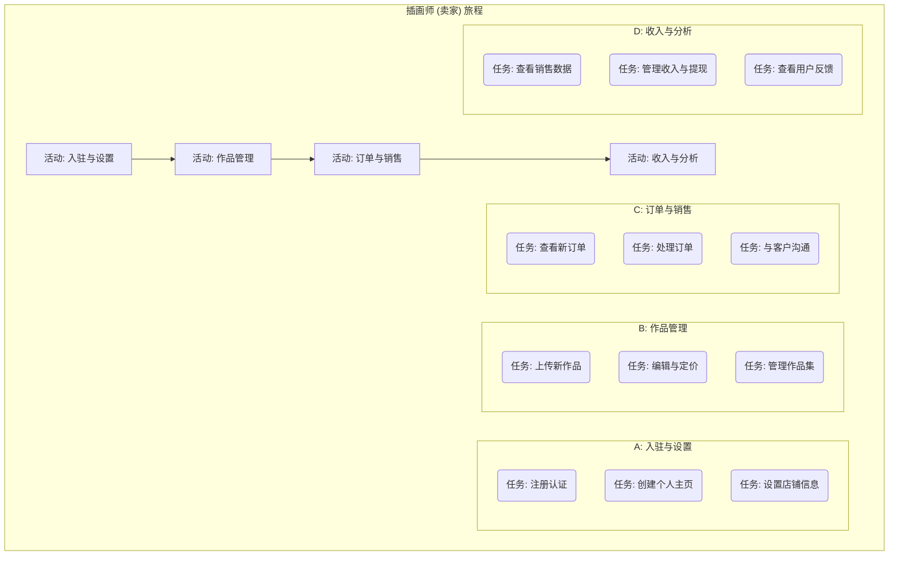
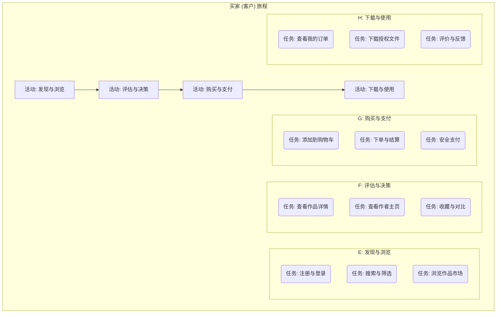

# KDP.Cool 交易平台 - 用户故事地图 (User Story Map)

## 1. 用户故事地图概述

### 1.1 项目背景与目标

**项目名称**: KDP.Cool - 插画作品交易平台
**核心目标**: 打造一个连接全球插画师与买家的专业数字艺术交易平台，实现从作品上传、展示、交易到交付的完整商业闭环。
**文档目的**: 本文档旨在将PRD中的宏观需求分解为以用户为中心的、可执行的用户故事，并规划版本迭代路径，指导敏捷开发。

### 1.2 核心用户角色 (Personas)

| 核心用户角色 | 描述 | 主要目标 |
| :--- | :--- | :--- |
| **插画师 (卖家)** | 数字艺术创作者，希望通过平台销售自己的作品，建立个人品牌。 | 获得收入、扩大影响力、高效管理作品。 |
| **买家 (客户)** | 需要高质量插画用于商业项目或个人收藏的个人或企业。 | 快速找到并购买到合适的、有正版授权的作品。 |
| **平台管理员** | 平台的运营和维护者。 | 保证平台稳定、内容合规、交易顺畅、用户满意。 |

### 1.3 用户故事地图结构

- **骨干 (Backbone)**: 由高阶用户活动（蓝色大卡片）构成，代表用户实现其目标所经历的主要阶段。
- **叙事流 (Narrative Flow)**: 在骨干之下，是具体的用户任务（史诗/Epics，绿色卡片），构成了完整的用户旅程。
- **故事细节 (Body)**: 在每个任务之下，是具体的用户故事（黄色卡片），这些是开发团队需要实现的功能点。
- **版本切片 (Release Slices)**: 水平切片代表不同的发布版本（MVP, V1.1, V2.0），确保每个版本都能交付完整的用户价值。

---

## 2. 插画师 (卖家) 用户旅程

**核心目标: 作为一名插画师，我想要入驻平台，上传并销售我的作品，最终成功获得收入。**

---

## 3. 买家 (客户) 用户旅程

**核心目标: 作为一名买家，我想要在平台上发现并购买到心仪的插画作品，并获得授权文件。**

---

## 4. 用户故事与版本规划

### 🔴 版本 1.0: MVP (最小可行产品)
**核心目标: 跑通核心交易流程。一个插画师可以上传作品，一个买家可以成功购买并下载该作品。**

| 用户故事 (Story) | 作为... (As a...) | 我想要... (I want to...) | 以便... (So that...) | 验收标准 (Acceptance Criteria) | 角色 | 史诗 (Epic) |
| :--- | :--- | :--- | :--- | :--- | :--- | :--- |
| **注册基础账户** | 新用户 | 通过邮箱和密码注册一个基础账户 | 能够登录并使用平台 | 1. 提供邮箱、密码即可注册。 2. 密码需加密存储。 3. 注册后自动登录。 | 插画师/买家 | 用户认证 |
| **创建插画师身份** | 注册用户 | 申请成为插画师并通过审核 | 开始上传和销售作品 | 1. 后台提供手动审核功能。 2. 审核通过后，用户角色变更为“插画师”。 | 插画师 | 用户认证 |
| **上传单个作品** | 插画师 | 上传一个作品，包含图片、标题、描述和标签 | 将我的作品发布到平台 | 1. 支持JPG, PNG格式。 2. 必填项：图片、标题。 3. 上传后作品状态为“已发布”。 | 插画师 | 作品管理 |
| **设置固定价格** | 插画师 | 为我的作品设置一个固定的售卖价格 | 让买家知道购买所需费用 | 1. 价格单位为元。 2. 0表示免费。 | 插画师 | 作品管理 |
| **浏览作品列表** | 买家 | 在一个公共页面上看到所有已发布的作品 | 发现平台上的可购作品 | 1. 默认按发布时间倒序排列。 2. 以网格形式展示作品缩略图和标题。 | 买家 | 发现与浏览 |
| **查看作品详情** | 买家 | 点击作品缩略图进入详情页，查看高清图和完整信息 | 详细了解作品，决定是否购买 | 1. 详情页展示：高清图、标题、描述、作者、价格。 | 买家 | 评估与决策 |
| **添加到购物车** | 买家 | 在作品详情页将作品加入购物车 | 准备一次性结算多个作品 | 1. 添加后，购物车图标显示商品数量。 2. 同一作品不能重复添加。 | 买家 | 购买与支付 |
| **查看购物车** | 买家 | 查看我的购物车页面 | 管理我准备购买的商品 | 1. 列表显示商品、价格、总价。 2. 可以移除商品。 | 买家 | 购买与支付 |
| **创建订单** | 买家 | 从购物车页面进行结算，创建一个待支付订单 | 锁定购买意向，准备支付 | 1. 点击“结算”后生成唯一订单号。 2. 订单包含商品信息和总金额。 | 买家 | 购买与支付 |
| **模拟支付** | 买家 | 点击“支付”按钮完成订单支付 | 完成购买流程 | 1. MVP阶段，点击按钮即视为支付成功。 2. 订单状态变更为“已支付”。 | 买家 | 购买与支付 |
| **查看已购订单** | 买家 | 在个人中心查看我的历史订单 | 找到我已购买的商品 | 1. 列表显示订单号、状态、金额、购买日期。 | 买家 | 下载与使用 |
| **下载作品文件** | 买家 | 在已支付的订单详情中，下载作品的原始文件 | 获得我购买的数字内容 | 1. 支付成功后，订单详情页出现下载按钮。 2. 点击可下载作者上传的原始文件。 | 买家 | 下载与使用 |
| **查看销售记录** | 插画师 | 在我的店铺管理中，看到我的作品被购买的记录 | 了解我的销售情况 | 1. 列表显示售出作品、售出时间、价格。 | 插画师 | 订单与销售 |

---

### 🟡 版本 1.1: 体验优化与商业完善
**核心目标: 完善用户体验，引入核心商业设置，让平台更具可用性。**

| 用户故事 (Story) | 作为... (As a...) | 我想要... (I want to...) | 以便... (So that...) | 验收标准 (Acceptance Criteria) | 角色 | 史诗 (Epic) |
| :--- | :--- | :--- | :--- | :--- | :--- | :--- |
| **创建个人主页** | 插画师 | 编辑我的个人主页，包含头像、简介和作品集 | 打造我的个人品牌，吸引买家 | 1. 可自定义头像、昵称、个人简介。 2. 主页自动展示所有已发布的作品。 | 插画师 | 入驻与设置 |
| **作品分类与搜索** | 买家 | 按分类浏览作品，或通过关键词搜索 | 更快地找到我想要的作品 | 1. 插画师上传时可选择预设分类。 2. 提供搜索框，可搜索作品标题和标签。 | 买家 | 发现与浏览 |
| **设置授权类型** | 插画师 | 为作品设置不同的授权类型（如个人版、商业版）和对应价格 | 满足不同买家的需求，实现收益最大化 | 1. 可添加至少两种授权类型。 2. 买家购买时需选择一种授权。 | 插画师 | 作品管理 |
| **集成真实支付** | 买家 | 使用支付宝或微信完成支付 | 安全、真实地完成交易 | 1. 集成支付宝和微信支付API。 2. 支付成功后回调能正确更新订单状态。 | 买家 | 购买与支付 |
| **管理提现账户** | 插画师 | 绑定我的支付宝账户作为提现方式 | 能够将我的收入提现 | 1. 输入支付宝账号和姓名进行绑定。 2. 后台可查看和管理。 | 插画师 | 收入与分析 |
| **发起提现请求** | 插画师 | 在我的收入页面，对可结算余额发起提现请求 | 将平台收入转到我的个人账户 | 1. 显示可提现金额。 2. 提交请求后，后台生成提现记录待处理。 | 插画师 | 收入与分析 |
| **作品评论与评分** | 买家 | 在购买并下载作品后，对作品进行评论和评分 | 为其他买家提供参考，并向作者反馈 | 1. 只有已购买用户才能评论。 2. 评论和评分显示在作品详情页。 | 买家 | 下载与使用 |
| **内容审核** | 平台管理员 | 在后台审核新上传的作品 | 确保平台内容的质量和合规性 | 1. 后台有作品审核列表。 2. 可通过或驳回作品，并填写理由。 | 管理员 | 平台管理 |

---

### 🟢 版本 2.0: 社区化与智能化
**核心目标: 增强社区互动，引入智能化功能，提升平台活跃度和用户粘性。**

| 用户故事 (Story) | 作为... (As a...) | 我想要... (I want to...) | 以便... (So that...) | 验收标准 (Acceptance Criteria) | 角色 | 史诗 (Epic) |
| :--- | :--- | :--- | :--- | :--- | :--- | :--- |
| **关注与粉丝系统** | 用户 | 关注我喜欢的插画师 | 及时获取他们的最新动态 | 1. 作者主页有“关注”按钮。 2. 个人中心有“我的关注”和“我的粉丝”列表。 | 插画师/买家 | 社区功能 |
| **作品收藏功能** | 买家 | 收藏我喜欢的作品到收藏夹 | 方便以后查找和购买 | 1. 作品上有“收藏”按钮。 2. 个人中心有“我的收藏”页面。 | 买家 | 评估与决策 |
| **个性化推荐** | 买家 | 在首页看到根据我的偏好推荐的作品 | 发现更多我可能感兴趣的内容 | 1. 基于浏览、收藏、购买历史进行推荐。 | 买家 | 发现与浏览 |
| **销售数据分析** | 插画师 | 在仪表盘看到我的作品浏览量、销量、收入的图表化分析 | 直观地了解我的店铺经营状况 | 1. 提供按时间维度的图表。 2. 展示热门作品排行。 | 插画师 | 收入与分析 |
| **优惠券与折扣** | 插画师 | 创建优惠券或对我的作品设置限时折扣 | 进行促销活动，提升销量 | 1. 可生成优惠码。 2. 买家在结算时可使用。 | 插画师 | 订单与销售 |
| **站内信与沟通** | 用户 | 与交易中的另一方通过站内信沟通 | 方便地咨询问题或讨论细节 | 1. 订单页提供沟通入口。 2. 新消息有站内提醒。 | 插画师/买家 | 社区功能 |
| **用户举报系统** | 用户 | 举报违规的作品或用户 | 帮助维护社区的健康环境 | 1. 提供举报入口和理由选择。 2. 管理员后台处理举报。 | 插画师/买家 | 平台管理 |
