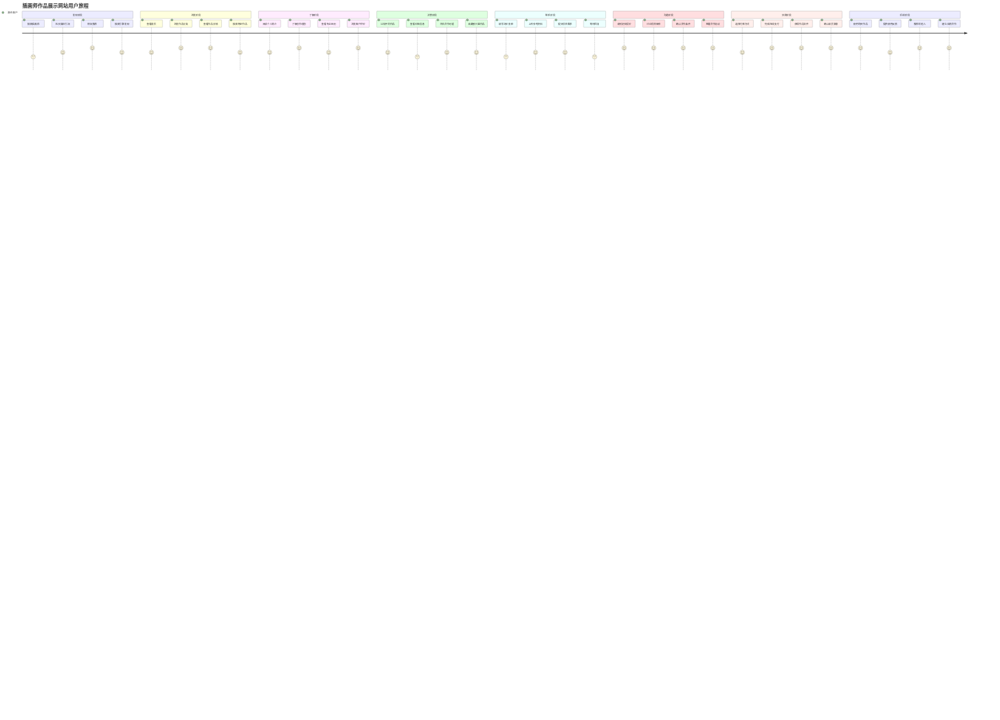
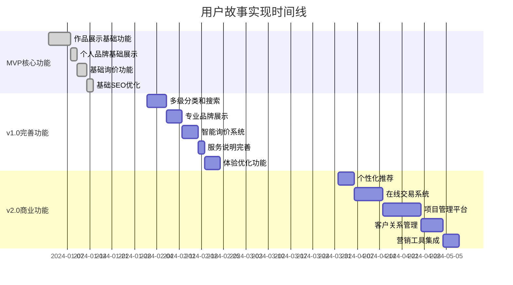
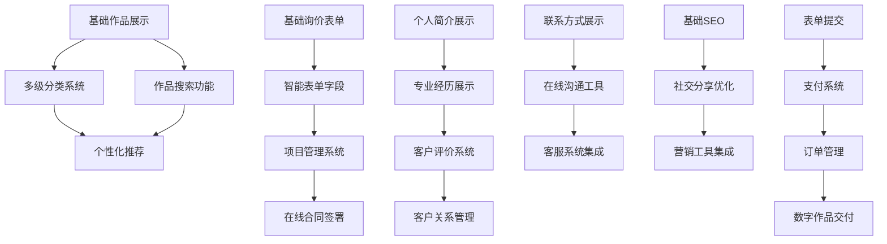
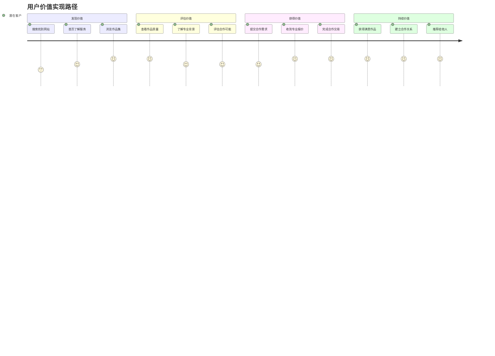

# 用户故事地图 (User Story Map)

## 1. 用户故事地图概述

### 1.1 项目背景与目标

**项目名称**: KDP.Cool - 插画师作品展示网站  
**核心目标**: 为插画师提供专业的个人品牌展示平台，实现作品展示到商业转化的完整闭环  
**主要用户**: 潜在客户、插画师本人、艺术爱好者  

### 1.2 核心用户旅程

用户故事地图采用横向表示用户活动流程，纵向表示具体任务的优先级分解，帮助团队理解用户完整的使用体验，并指导产品功能的优先级规划。

**主要用户旅程**:
发现网站 → 浏览作品 → 了解插画师 → 产生兴趣 → 联系询价 → 确认合作 → 完成交易 → 后续合作

### 1.3 故事地图使用说明

- **横轴（用户活动）**: 用户完成目标的主要活动步骤
- **纵轴（任务优先级）**: 从上到下按优先级排列具体任务
- **版本映射**: 不同颜色标识对应不同版本的功能
- **用户价值**: 每个任务都明确对应的用户价值

## 2. 用户活动流 (横向)

### 2.1 主要用户活动

### 2.2 活动顺序与关联

| 活动阶段 | 核心目标 | 关键成功因素 | 潜在流失点 |
|----------|----------|--------------|------------|
| 发现阶段 | 吸引目标用户访问 | SEO优化、社交推广、口碑传播 | 网站加载慢、首印象差 |
| 浏览阶段 | 展示专业作品质量 | 作品质量、展示效果、分类清晰 | 作品加载慢、分类混乱 |
| 了解阶段 | 建立专业信任感 | 个人品牌、创作理念、专业背景 | 信息不足、缺乏说服力 |
| 决策阶段 | 促进合作意向 | 作品匹配度、价格合理、案例丰富 | 价格不透明、缺乏参考 |
| 联系阶段 | 降低沟通门槛 | 表单简洁、响应及时、流程清晰 | 表单复杂、回复延迟 |
| 沟通阶段 | 确定合作细节 | 专业沟通、方案合理、服务周到 | 沟通不畅、期望不符 |
| 交易阶段 | 完成商业转化 | 支付便捷、交付及时、质量保证 | 支付问题、交付延迟 |
| 后续阶段 | 建立长期关系 | 服务满意、持续价值、口碑传播 | 服务不佳、缺乏跟进 |

## 3. 用户任务分解 (纵向)

### 3.1 发现阶段 - 用户任务

#### 🔴 MVP必须功能 (P0)
- **基础SEO优化**
  - 用户故事: 作为潜在客户，我希望能通过搜索引擎找到插画师网站，以便发现合适的合作伙伴
  - 验收标准: 网站能被搜索引擎正常收录，关键词搜索能找到网站
  - 开发工作量: 1天

- **网站基础信息展示**
  - 用户故事: 作为访问者，我希望快速了解这是什么网站，以便判断是否继续浏览
  - 验收标准: 首页清晰展示插画师身份和主要服务
  - 开发工作量: 0.5天

#### 🟡 v1.0重要功能 (P1)
- **社交媒体分享优化**
  - 用户故事: 作为用户，我希望分享网站时有良好的预览效果，以便吸引更多人访问
  - 验收标准: 分享到微信、微博等平台时显示正确的标题、描述和图片
  - 开发工作量: 1天

- **移动端搜索优化**
  - 用户故事: 作为移动端用户，我希望在手机上搜索时能方便地找到和访问网站
  - 验收标准: 移动端搜索结果显示友好，页面适配良好
  - 开发工作量: 1天

#### 🟢 v2.0增强功能 (P2)
- **搜索广告投放支持**
  - 用户故事: 作为插画师，我希望能投放搜索广告吸引更多客户，以便扩大业务
  - 验收标准: 支持Google Ads、百度推广等广告平台的转化跟踪
  - 开发工作量: 2天

### 3.2 浏览阶段 - 用户任务

#### 🔴 MVP必须功能 (P0)
- **作品网格展示**
  - 用户故事: 作为潜在客户，我希望能快速浏览所有作品，以便了解插画师的整体水平
  - 验收标准: 作品以网格形式整齐展示，缩略图清晰，加载速度快
  - 开发工作量: 2天

- **作品详情查看**
  - 用户故事: 作为潜在客户，我希望能查看作品的高清大图，以便评估作品质量和细节
  - 验收标准: 点击作品能查看高清大图，支持缩放和全屏查看
  - 开发工作量: 3天

- **基础分类浏览**
  - 用户故事: 作为潜在客户，我希望能按类别浏览作品，以便快速找到我需要的风格
  - 验收标准: 提供3-5个主要分类，分类切换流畅
  - 开发工作量: 2天

#### 🟡 v1.0重要功能 (P1)
- **多级分类系统**
  - 用户故事: 作为潜在客户，我希望能通过更细致的分类找到精确匹配的作品
  - 验收标准: 支持风格、主题、时间等多维度分类，最多3级分类
  - 开发工作量: 3天

- **作品搜索功能**
  - 用户故事: 作为潜在客户，我希望能搜索特定关键词找到相关作品
  - 验收标准: 支持标题、标签、描述的关键词搜索，搜索结果准确
  - 开发工作量: 2天

- **作品筛选功能**
  - 用户故事: 作为潜在客户，我希望能按多个条件筛选作品，以便精确找到需要的内容
  - 验收标准: 支持按风格、颜色、尺寸、时间等条件筛选
  - 开发工作量: 3天

- **图片懒加载优化**
  - 用户故事: 作为用户，我希望页面能快速加载，不会因为图片太多而卡顿
  - 验收标准: 图片按需加载，首屏加载时间<3秒
  - 开发工作量: 1天

#### 🟢 v2.0增强功能 (P2)
- **个性化推荐**
  - 用户故事: 作为回访用户，我希望能看到推荐的相关作品，以便发现更多感兴趣的内容
  - 验收标准: 基于浏览历史推荐相关作品，推荐准确率>60%
  - 开发工作量: 5天

- **作品收藏功能**
  - 用户故事: 作为潜在客户，我希望能收藏感兴趣的作品，以便后续对比和决策
  - 验收标准: 支持作品收藏和收藏夹管理
  - 开发工作量: 2天

### 3.3 了解阶段 - 用户任务

#### 🔴 MVP必须功能 (P0)
- **基础个人简介**
  - 用户故事: 作为潜在客户，我希望了解插画师的基本信息，以便判断是否适合合作
  - 验收标准: 展示姓名、头像、职业、联系方式等基本信息
  - 开发工作量: 1天

- **创作理念展示**
  - 用户故事: 作为潜在客户，我希望了解插画师的创作理念，以便判断风格是否匹配
  - 验收标准: 支持富文本展示创作理念和艺术观点
  - 开发工作量: 1天

#### 🟡 v1.0重要功能 (P1)
- **专业经历展示**
  - 用户故事: 作为潜在客户，我希望了解插画师的专业背景，以便评估其专业能力
  - 验收标准: 时间线形式展示教育背景、工作经历、获奖情况
  - 开发工作量: 2天

- **技能标签展示**
  - 用户故事: 作为潜在客户，我希望快速了解插画师擅长的技能和工具
  - 验收标准: 标签云形式展示专业技能，支持点击查看相关作品
  - 开发工作量: 1天

- **客户评价展示**
  - 用户故事: 作为潜在客户，我希望看到其他客户的评价，以便增强合作信心
  - 验收标准: 展示客户评价和评分，支持评价的真实性验证
  - 开发工作量: 2天

#### 🟢 v2.0增强功能 (P2)
- **创作过程展示**
  - 用户故事: 作为潜在客户，我希望了解插画师的创作过程，以便更好地理解其专业性
  - 验收标准: 支持展示创作步骤、工具使用、时间投入等信息
  - 开发工作量: 3天

- **合作案例详述**
  - 用户故事: 作为潜在客户，我希望看到详细的合作案例，以便了解合作流程和效果
  - 验收标准: 展示完整的项目案例，包括需求、过程、结果
  - 开发工作量: 2天

### 3.4 决策阶段 - 用户任务

#### 🔴 MVP必须功能 (P0)
- **联系方式展示**
  - 用户故事: 作为潜在客户，我希望能方便地找到联系方式，以便进行咨询
  - 验收标准: 清晰展示邮箱、电话等联系方式，支持一键复制
  - 开发工作量: 0.5天

#### 🟡 v1.0重要功能 (P1)
- **服务范围说明**
  - 用户故事: 作为潜在客户，我希望了解插画师提供哪些服务，以便确认是否符合需求
  - 验收标准: 清晰列出服务类型、交付形式、合作流程
  - 开发工作量: 1天

- **价格范围指导**
  - 用户故事: 作为潜在客户，我希望了解大概的价格范围，以便评估预算匹配度
  - 验收标准: 提供不同类型项目的价格区间参考
  - 开发工作量: 1天

#### 🟢 v2.0增强功能 (P2)
- **在线价格计算器**
  - 用户故事: 作为潜在客户，我希望能根据项目需求估算价格，以便做预算规划
  - 验收标准: 根据项目类型、复杂度、周期等因素计算参考价格
  - 开发工作量: 4天

- **作品对比功能**
  - 用户故事: 作为潜在客户，我希望能对比不同作品，以便做出最佳选择
  - 验收标准: 支持选择多个作品进行并排对比
  - 开发工作量: 2天

### 3.5 联系阶段 - 用户任务

#### 🔴 MVP必须功能 (P0)
- **基础询价表单**
  - 用户故事: 作为潜在客户，我希望能通过表单提交项目需求，以便获得专业报价
  - 验收标准: 包含联系信息、项目类型、预算、描述等基础字段
  - 开发工作量: 2天

- **表单提交确认**
  - 用户故事: 作为潜在客户，我希望提交表单后能收到确认，以便知道信息已成功发送
  - 验收标准: 提交成功后显示确认页面，发送确认邮件
  - 开发工作量: 1天

#### 🟡 v1.0重要功能 (P1)
- **智能表单字段**
  - 用户故事: 作为潜在客户，我希望表单能根据项目类型显示相关字段，以便提供更准确的信息
  - 验收标准: 根据选择的项目类型动态显示相关字段
  - 开发工作量: 2天

- **文件上传功能**
  - 用户故事: 作为潜在客户，我希望能上传参考图片或文档，以便更好地说明需求
  - 验收标准: 支持图片、PDF等格式文件上传，文件大小限制10MB
  - 开发工作量: 2天

- **表单验证优化**
  - 用户故事: 作为潜在客户，我希望填写表单时能及时得到提示，以便避免提交错误信息
  - 验收标准: 实时验证必填字段、邮箱格式、电话格式等
  - 开发工作量: 1天

#### 🟢 v2.0增强功能 (P2)
- **项目需求模板**
  - 用户故事: 作为潜在客户，我希望能使用预设模板快速填写需求，以便节省时间
  - 验收标准: 提供常见项目类型的需求模板
  - 开发工作量: 2天

- **在线沟通工具**
  - 用户故事: 作为潜在客户，我希望能直接在网站上进行实时沟通，以便快速解决疑问
  - 验收标准: 集成在线客服或聊天工具
  - 开发工作量: 3天

### 3.6 沟通阶段 - 用户任务

#### 🟡 v1.0重要功能 (P1)
- **询价状态跟踪**
  - 用户故事: 作为潜在客户，我希望能查看询价处理状态，以便了解进展情况
  - 验收标准: 提供询价状态查询功能，显示处理进度
  - 开发工作量: 2天

#### 🟢 v2.0增强功能 (P2)
- **项目管理界面**
  - 用户故事: 作为客户，我希望能在线查看项目进度，以便及时了解工作状态
  - 验收标准: 提供项目进度查看、文件交付、沟通记录等功能
  - 开发工作量: 5天

- **在线合同签署**
  - 用户故事: 作为客户，我希望能在线签署合作协议，以便简化合作流程
  - 验收标准: 支持电子合同生成、在线签署、法律效力保障
  - 开发工作量: 4天

### 3.7 交易阶段 - 用户任务

#### 🟢 v2.0增强功能 (P2)
- **在线支付系统**
  - 用户故事: 作为客户，我希望能在线支付项目费用，以便快速完成交易
  - 验收标准: 支持支付宝、微信支付、银行卡等多种支付方式
  - 开发工作量: 4天

- **订单管理系统**
  - 用户故事: 作为客户，我希望能查看订单状态和交易记录，以便管理采购信息
  - 验收标准: 提供完整的订单管理功能，包括状态跟踪、发票开具等
  - 开发工作量: 3天

- **数字作品交付**
  - 用户故事: 作为客户，我希望支付后能立即获得数字作品，以便快速使用
  - 验收标准: 支付成功后自动发送下载链接，文件安全可靠
  - 开发工作量: 2天

### 3.8 后续阶段 - 用户任务

#### 🟡 v1.0重要功能 (P1)
- **客户反馈收集**
  - 用户故事: 作为插画师，我希望能收集客户反馈，以便改进服务质量
  - 验收标准: 提供评价和反馈收集功能
  - 开发工作量: 2天

#### 🟢 v2.0增强功能 (P2)
- **客户关系管理**
  - 用户故事: 作为插画师，我希望能管理客户信息，以便维护长期合作关系
  - 验收标准: 提供客户信息管理、沟通记录、合作历史等功能
  - 开发工作量: 4天

- **推荐奖励系统**
  - 用户故事: 作为满意客户，我希望推荐朋友时能获得奖励，以便获得额外价值
  - 验收标准: 提供推荐链接生成、奖励发放、推荐统计等功能
  - 开发工作量: 3天

## 4. 版本规划对应

### 4.1 优先级分类

#### MVP版本 (🔴 P0功能)
**核心价值验证，必须包含的最小功能集**

| 功能模块 | 具体功能 | 用户价值 | 开发工作量 |
|----------|----------|----------|------------|
| 作品展示 | 网格展示、详情查看、基础分类 | 展示专业能力 | 7天 |
| 个人品牌 | 基础简介、创作理念 | 建立信任感 | 2天 |
| 联系询价 | 基础表单、提交确认 | 商业转化入口 | 3天 |
| 基础优化 | SEO优化、网站信息 | 用户发现和理解 | 1.5天 |
| **总计** | **13.5天** | **验证核心假设** | **约3周** |

#### v1.0版本 (🟡 P1功能)
**完善用户体验，建立产品竞争力**

| 功能模块 | 具体功能 | 用户价值 | 开发工作量 |
|----------|----------|----------|------------|
| 作品浏览 | 多级分类、搜索筛选、懒加载 | 提升浏览效率 | 6天 |
| 个人品牌 | 专业经历、技能标签、客户评价 | 增强专业形象 | 5天 |
| 联系优化 | 智能表单、文件上传、验证优化 | 降低沟通成本 | 5天 |
| 服务说明 | 服务范围、价格指导 | 明确合作预期 | 2天 |
| 其他功能 | 社交分享、状态跟踪、反馈收集 | 提升整体体验 | 5天 |
| **总计** | **23天** | **完善产品体验** | **约5周** |

#### v2.0版本 (🟢 P2功能)
**商业化增强，建立完整生态**

| 功能模块 | 具体功能 | 用户价值 | 开发工作量 |
|----------|----------|----------|------------|
| 智能化功能 | 个性化推荐、价格计算器 | 提升用户体验 | 9天 |
| 交易系统 | 在线支付、订单管理、数字交付 | 完整商业闭环 | 9天 |
| 项目管理 | 进度跟踪、在线合同、沟通工具 | 专业服务体验 | 12天 |
| 客户管理 | CRM系统、推荐奖励 | 长期价值挖掘 | 7天 |
| 营销工具 | 广告支持、案例展示 | 业务增长支持 | 5天 |
| **总计** | **42天** | **商业化完善** | **约8周** |

### 4.2 Roadmap版本映射

### 4.3 功能依赖关系

## 5. 用户价值映射

### 5.1 核心用户价值

| 用户类型 | 核心需求 | 对应功能 | 价值实现 |
|----------|----------|----------|----------|
| **潜在客户** | 快速找到合适插画师 | 作品分类、搜索筛选 | 提升匹配效率 |
| **潜在客户** | 评估插画师专业能力 | 作品展示、专业经历 | 建立信任基础 |
| **潜在客户** | 便捷的合作流程 | 询价表单、在线支付 | 降低合作门槛 |
| **插画师** | 展示专业形象 | 个人品牌、作品展示 | 提升个人价值 |
| **插画师** | 获得商业机会 | 询价系统、客户管理 | 实现商业转化 |
| **插画师** | 提升工作效率 | 项目管理、自动化工具 | 优化工作流程 |

### 5.2 价值实现路径

---

**文档版本**: v1.0  
**最后更新**: 2024-01-01  
**文档状态**: 待评审  
**相关文档**: PRD.md, Roadmap.md, Metrics_Framework.md  
**下一步行动**: 开发团队评审 → 工作量估算确认 → 迭代计划制定